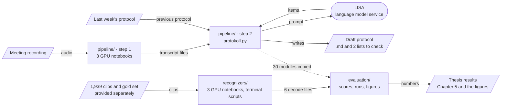
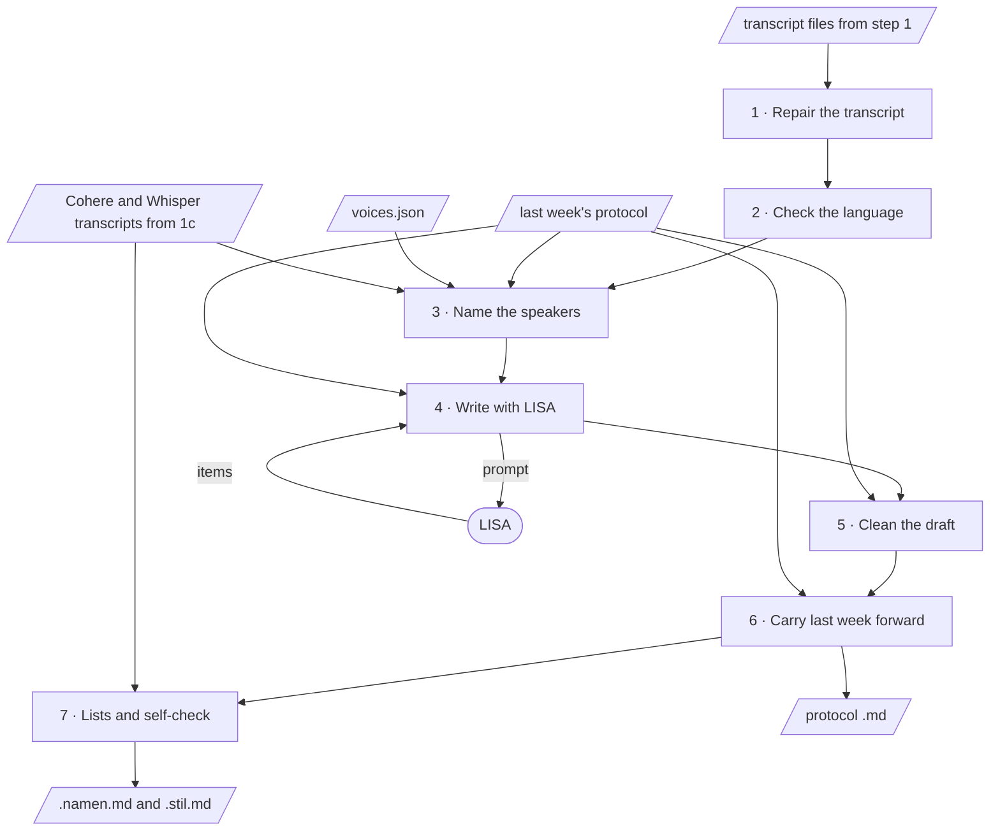
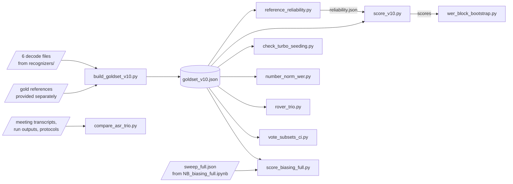
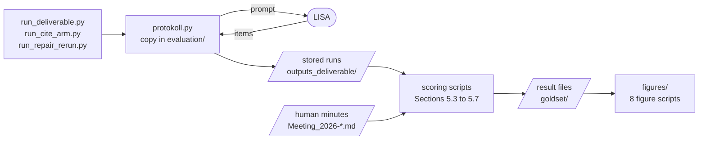

# Codebase map

How the 209 files of this repository fit together: the two routes through the code, the order of the steps, and every file with what it imports and which files use it. 176 files are different, and 33 are identical copies (see [All 209 files](#all-209-files)). File names link to the files.

## How the parts connect

Two routes run through the code. The top route is the system: step 1 transcribes the recording on a GPU, and step 2 writes the protocol with LISA. The bottom route produced the thesis numbers: the recognizers decode 1,939 clips, and the evaluation scores them. The evaluation also replays step 2, so it holds 30 identical copies of pipeline modules. `recognizers/` holds 3 more copies.

`environments/` sets up the three Python environments on JupyterHub. `tests/` holds 87 automatic checks of all three code folders, and `tools/` keeps the copies identical.

## From recording to protocol

Everything runs on the university JupyterHub. Step 1 runs once per recording in three notebooks. Step 2 is one command in the terminal.

### Step 1: GPU notebooks in `pipeline/cluster/`

| | Notebook | Runs on | What it does | Uses | Writes into `outputs/<MEETING>/` |
|---|---|---|---|---|---|
| 1a | [`cluster/step1a_canary_transcribe.ipynb`](pipeline/cluster/step1a_canary_transcribe.ipynb) | GPU · kernel “NeMo ASR” | Converts the recording to 16 kHz mono and transcribes it with Canary-1B-v2, with a time for every word. | [`thesis_pipeline/canary_diarize.py`](pipeline/thesis_pipeline/canary_diarize.py) | `<audio>_16k_mono.wav` `_words_step1a.json` |
| 1b | [`cluster/step1b_pyannote_speakers.ipynb`](pipeline/cluster/step1b_pyannote_speakers.ipynb) | GPU · kernel “PyAnnote Diarization” | Finds who speaks when and gives every word the speaker active at its midpoint. | [`thesis_pipeline/canary_diarize.py`](pipeline/thesis_pipeline/canary_diarize.py), [`thesis_pipeline/env.py`](pipeline/thesis_pipeline/env.py) | `transcript_speakers.txt` `transcript_canary_ts.json` `diarization_hyp.rttm` |
| 1c | [`cluster/step1c_cohere_whisper_transcribe.ipynb`](pipeline/cluster/step1c_cohere_whisper_transcribe.ipynb) | GPU · kernel “NeMo ASR” · optional | Cohere Transcribe and Whisper large-v3-turbo-German transcribe the same speaker turns, so step 2 can compare three recognizers for the names. | [`asr_chunks.py`](pipeline/asr_chunks.py), [`speaker_turns_v11.py`](pipeline/speaker_turns_v11.py), [`transcript_repair.py`](pipeline/transcript_repair.py), [`thesis_pipeline/env.py`](pipeline/thesis_pipeline/env.py) | `transcript_speakers_cohere.txt` `transcript_speakers_whisper_turbo_de.txt` `step1c_segments.json` |

### Step 2: `protokoll.py`, seven stages in this order

| | Stage | What it does | Files | Reads | Writes |
|---|---|---|---|---|---|
| 1 | Repair the transcript | Applies the sentence rule, checks short sentences by voice, shapes the turns and re-transcribes speech that Canary dropped. Notes when each person's report starts. | [`transcript_repair.py`](pipeline/transcript_repair.py), [`speaker_turns_v11.py`](pipeline/speaker_turns_v11.py), [`verify_short_turns.py`](pipeline/verify_short_turns.py), [`gap_recover.py`](pipeline/gap_recover.py), [`handover_naming.py`](pipeline/handover_naming.py) | `--transcript`, and the word list and speaker turns next to it the recording | `.transcript.txt` `.repair.json` |
| 2 | Check the language | Refuses a transcript that is not German (exit code 2) and removes Chinese filler characters. | [`generate_protocols.py`](pipeline/generate_protocols.py), [`language_gate.py`](pipeline/language_gate.py) | – | – |
| 3 | Name the speakers | First by voice profiles of earlier meetings, then by handover phrases matched by sound against the people of last week's protocol, then by topic. `--speakers` skips this and uses a given list. | [`voice_profiles.py`](pipeline/voice_profiles.py), [`handover_naming.py`](pipeline/handover_naming.py), [`attribution_baselines.py`](pipeline/attribution_baselines.py), [`evaluate_speaker_attribution.py`](pipeline/evaluate_speaker_attribution.py) | `--previous` `--voices` `--also-transcript` | – |
| 4 | Write with LISA | Sends the transcript, the names and terms of last week's protocol and example lines of its style to LISA, which writes this meeting's items. Exit code 1 if LISA does not answer. | [`generate_protocols.py`](pipeline/generate_protocols.py), [`term_source.py`](pipeline/term_source.py), [`style_exemplars.py`](pipeline/style_exemplars.py) | `--previous` `--history` (with `--history-vocab`) LISA (`--lisa`) | – |
| 5 | Clean the draft | Replaces the one known foreign word, repairs headings and bullets, respells names from last week's protocol, restores or flags invented names, and warns about doubtful owners. | [`known_leaks.py`](pipeline/known_leaks.py), [`normalize_structure.py`](pipeline/normalize_structure.py), [`protocol_repair.py`](pipeline/protocol_repair.py), [`validate_protocols_v10.py`](pipeline/validate_protocols_v10.py), [`entity_correct.py`](pipeline/entity_correct.py), [`invented_names.py`](pipeline/invented_names.py) | `--previous` | – |
| 6 | Carry last week forward | Copies last week's protocol, inserts the new items under their person and topic, and orders the sections by the audio. Carried items not heard this week get `[ÜBERTRAG]`. With `--older`, carried items that were new last week get `[PRÜFEN]` instead. | [`carry_forward.py`](pipeline/carry_forward.py), [`postedit_effort.py`](pipeline/postedit_effort.py), [`carry_tag.py`](pipeline/carry_tag.py), [`stale_flag.py`](pipeline/stale_flag.py) | `--previous` `--older` | `.neu.md` (this meeting only) `.md` (the protocol) |
| 7 | Lists and self-check | Lists the names to check and the bullets in noun style, then checks the structure. Exit code 2 if a rule fails. The protocol is written anyway. | [`name_check.py`](pipeline/name_check.py), [`name_align.py`](pipeline/name_align.py), [`style_flag.py`](pipeline/style_flag.py), [`thesis_pipeline/protocol_validate.py`](pipeline/thesis_pipeline/protocol_validate.py), [`validate_protocols_v10.py`](pipeline/validate_protocols_v10.py) | `--also-transcript` `--history` | `.namen.md` `.stil.md` |

Points to know:

- Without `--transcript`, `protokoll.py` stops. `--transcribe-here` transcribes locally with a different design, so its results cannot be compared with the thesis.
- `--cite` needs `segment_cite.py`, which is not in the repository. The program then stops with a message.
- The protocols of the thesis were written by LISA Pro in the version `lisa-pro-03-2026`. LISA Pro now runs on a new model, so a new run writes different protocols.

## The six recognizers

`recognizers/` decodes the same 1,939 clips of the eight team meetings with all six recognizers. The notebooks run on a GPU with the kernel “NeMo ASR”, and the scripts run in the terminal.

| Code name | Model |
|---|---|
| `canary_diar` | `nvidia/canary-1b-v2` |
| `whisper_large_v3` | `openai/whisper-large-v3` |
| `whisper_turbo` | `openai/whisper-large-v3-turbo` |
| `whisper_turbo_de` | `primeline/whisper-large-v3-turbo-german` |
| `cohere` | `CohereLabs/cohere-transcribe-03-2026` |
| `granite41` | `ibm-granite/granite-speech-4.1-2b` |

### Steps in this order

| | Runs on | Step | Files | Writes |
|---|---|---|---|---|
| 1 | GPU | **Decode the clips with the six recognizers.** The 147 gold clips first, then the rest of the 1,939. | [`NB_v10_asr.ipynb`](recognizers/NB_v10_asr.ipynb) | `goldset/clip_asr_v10/<code name>__v10.json` (6 files) |
| 2 | GPU | **Decode the long clips again with Whisper.** The three Whisper models returned no text for the 219 clips longer than 30 s. This notebook decodes them again in pieces cut at quiet points. | [`NB_whisper_long.ipynb`](recognizers/NB_whisper_long.ipynb), [`asr_chunks.py`](recognizers/asr_chunks.py), [`whisper_empty_segments.json`](recognizers/whisper_empty_segments.json) | `whisper_long_redecode/<code name>.json` |
| 3 | Terminal | **Merge the long clips.** Fills those texts into the three Whisper files, with a backup. | [`whisper_long_redecode.py`](recognizers/whisper_long_redecode.py) | the three Whisper files of `goldset/clip_asr_v10/` |
| 4 | Terminal | **Gate the clips and build the transcripts.** Marks clips that loop or are empty, joins the clip texts into one transcript per meeting and recognizer, and checks each transcript. | [`segment_loop_gate.py`](recognizers/segment_loop_gate.py), [`assemble_v9_transcripts.py`](recognizers/assemble_v9_transcripts.py), [`transcript_gate.py`](recognizers/transcript_gate.py) | `goldset/segment_loop_gate.json` `outputs_v10/<code name>/<meeting>/` `transcript_gate_v10.json` |
| 5 | GPU | **Decoder biasing (for one result only).** Canary-1B-v2 twice at beam 4, without and with a boost toward the names of each meeting's previous protocol. | [`NB_biasing_full.ipynb`](recognizers/NB_biasing_full.ipynb) | `bias_full/sweep_full.json`, copied to `evaluation/` |
| 6 | | **Continue in [`evaluation/`](evaluation/README.md).** The six decode files and `sweep_full.json` are its inputs. | | |

### Optional: cut the segments and clips again

The thesis scored the provided clips. These four scripts rebuild them, in this order, for a comparison with the frozen files: [`repair_word_speakers.py`](recognizers/repair_word_speakers.py) → [`resegment_v9.py`](recognizers/resegment_v9.py) → [`flag_edge_words.py`](recognizers/flag_edge_words.py) → [`cut_clips_v9.py`](recognizers/cut_clips_v9.py).

Functions they use: [`resegment_v7.py`](recognizers/resegment_v7.py), [`resegment_v8.py`](recognizers/resegment_v8.py), [`boundary_lib.py`](recognizers/boundary_lib.py), [`boundary_signals.py`](recognizers/boundary_signals.py), [`build_clip_dataset.py`](recognizers/build_clip_dataset.py), [`rater_notes.py`](recognizers/rater_notes.py), [`thesis_pipeline/goldset_local.py`](recognizers/thesis_pipeline/goldset_local.py), [`thesis_pipeline/asr_quality.py`](recognizers/thesis_pipeline/asr_quality.py), [`thesis_pipeline/text_norm.py`](recognizers/thesis_pipeline/text_norm.py).

## The thesis numbers

### The recognizers (Sections 5.1 to 5.3)

Twelve scripts in `evaluation/` compute the recognizer results on the CPU. They read the decodes of `recognizers/` and data provided separately.

`build_goldset_v10.py` builds the gold set first. Every other scoring script reads that one file. Two results feed a later script: the reader agreement goes into `score_v10.py`, and its scores go into `wer_block_bootstrap.py`. `compare_asr_trio.py` stands apart: it replays the speaker naming of `protokoll.py` on the meeting transcripts.

| Script, in run order | Writes | Result | Section |
|---|---|---|---|
| [`build_goldset_v10.py`](evaluation/build_goldset_v10.py) | `goldset/goldset_v10.json` | the gold set of 147 clips | 5.1 |
| [`reference_reliability.py`](evaluation/reference_reliability.py) | `goldset/reference_reliability.json` | two readers of the reference disagree by 0.076 WER on 48 clips | 5.1 |
| [`score_v10.py`](evaluation/score_v10.py) | `goldset/score_v10_2026-10-01.json` (`--json`) | WER and CER of the six recognizers, intervals, paired tests with Holm correction | 5.2 |
| [`wer_block_bootstrap.py`](evaluation/wer_block_bootstrap.py) | `goldset/wer_block_bootstrap_2026-10-01.json` | the paired tests with clips resampled in blocks | 5.2 |
| [`check_turbo_seeding.py`](evaluation/check_turbo_seeding.py) | (prints only) | WER on the clips that no recognizer reproduces exactly | 5.2 |
| [`number_norm_wer.py`](evaluation/number_norm_wer.py) | (prints only) | WER with numbers normalized | 5.2 |
| [`rover_trio.py`](evaluation/rover_trio.py) | `goldset/rover_trio_2026-10-09.json` | word vote: Canary-1B-v2 alone 0.099, the vote of the final three 0.082 | 5.2 |
| [`vote_subsets_ci.py`](evaluation/vote_subsets_ci.py) | `goldset/vote_subsets_2026-10-10.json` | the gain of the vote on parts of the gold set | 5.2 |
| [`vote_vs_singles.py`](evaluation/vote_vs_singles.py) | `goldset/vote_vs_singles_2026-10-25.json` | the kept vote against each single recognizer | 5.2 |
| [`whisper_lineage_closeness.py`](evaluation/whisper_lineage_closeness.py) | `goldset/whisper_lineage_closeness_2026-10-29.json` | how close each output is to that of Whisper large-v3-turbo, the basis of the "+" marks | 4.5, 5.2 |
| [`compare_asr_trio.py`](evaluation/compare_asr_trio.py) | `goldset/asr_trio_comparison.json` | speaker naming replayed with the evaluated and the final three recognizers: the same 34 names | 4.5, 5.3 |
| [`score_biasing_full.py`](evaluation/score_biasing_full.py) | `goldset/bias_full_scores.json` | decoder biasing toward names of the previous protocol, five rules fixed before the run | 5.3 |

### The protocols (Sections 5.3 to 5.7)

Three scripts wrote the protocol runs with LISA. The scoring scripts read the stored runs and the human minutes and need no LISA.

| Script, in run order | Writes | Result | Section |
|---|---|---|---|
| [`name_reachability.py`](evaluation/name_reachability.py) | `goldset/name_reachability.json` | Sorts each name that the minutes and the recognizers spell differently: in the prompt name list, only in the previous document, or nowhere in it. | 5.3 |
| [`name_cases_after_repair.py`](evaluation/name_cases_after_repair.py) | `goldset/name_cases_after_repair_2026-10-29.json` | Scores every run on the name cases drawn before and after the Whisper re-decode: right, wrong, absent or undecidable. | 5.3 |
| [`name_check_eval.py`](evaluation/name_check_eval.py) | prints | Defines the name cases (Kölner Phonetik and a similarity of at least 0.6) and measures recall and precision of the names-to-check list. | 5.3 |
| [`name_ab_score.py`](evaluation/name_ab_score.py) | `goldset/name_ab_score.json` | Compares name spellings of protocols written without and with prompt rules 5a and 5b, with a sign test and a Wilcoxon test. | 5.3 |
| [`name_majority_gate.py`](evaluation/name_majority_gate.py) | prints | Tests whether a majority vote of the recognizers would fix or break the name spellings of the protocols. | 5.3 |
| [`entity_recover.py`](evaluation/entity_recover.py) | prints; `--apply` writes `goldset/entity_recover.json` | Constrained entity correction after the RECOVER method; each edit is checked against the minutes of the same meeting. | 5.3 |
| [`koelner_fix_replay.py`](evaluation/koelner_fix_replay.py) | `goldset/koelner_fix_replay_2026-10-10.json` | Replays the naming steps with the original and with a corrected Kölner Phonetik function and lists where they differ. | 5.3 |
| [`near_flag_gate.py`](evaluation/near_flag_gate.py) | prints | Labels each previous-document name suggestion that reaches a protocol as right, wrong or undecidable. | 5.3 |
| [`name_flag_context_check.py`](evaluation/name_flag_context_check.py) | `goldset/name_flag_context_check_2026-10-01.json` | Asks LISA whether each name suggestion is a real misrecognition, given its two context sentences, and scores the answers. | 5.3 |
| [`qa_protocols.py`](evaluation/qa_protocols.py) | `outputs_deliverable/qa_report.json` | Layered quality check of a run: transcript, structure, content, names, reference and style; also finds one name in two spellings. | 5.3 |
| [`build_der_app.py`](evaluation/build_der_app.py) | `dist/der_annotation/` | Draws 240 frames of 2 s and builds the listening page on which each frame was labeled with its speaker. | 5.4 |
| [`score_der.py`](evaluation/score_der.py) | `goldset/der_result.json` | Scores the labeled frames: miss, false alarm and confusion with a Wilson interval, for three systems. | 5.4 |
| [`speaker_identity.py`](evaluation/speaker_identity.py) | `goldset/speaker_identity.json` (with `--apply`) | Reference naming of the diarization speakers from the attendance record, with voice embeddings and Hungarian assignment. | 5.4 |
| [`evaluate_diarization.py`](evaluation/evaluate_diarization.py) | `pipeline_outputs_extracted/evaluation/layer3_diarization.json` | Number of diarization clusters and speaking shares per meeting against the attendance record. | 5.4 |
| [`score_deliverable.py`](evaluation/score_deliverable.py) | prints | Checks each voice name of a run against goldset/speaker_identity.json and scores topic attribution. | 5.4 |
| [`speaking_order_test.py`](evaluation/speaking_order_test.py) | prints | Reporting order recovered from the diarization (longest block of speech) against the order of the minutes, with roster and random baselines. | 5.4 |
| [`order_rule_compare.py`](evaluation/order_rule_compare.py) | prints | Compares the first-utterance rule with the longest-block rule for the order of the report sections. | 5.4 |
| [`ladder_split.py`](evaluation/ladder_split.py) | `goldset/ladder_split.json` | Topic ownership against the baseline 'last week's owner', split by whether the owner said the topic in the meeting. | 5.4 |
| [`attribution_blocklevel.py`](evaluation/attribution_blocklevel.py) | `outputs_deliverable/attribution_blocklevel.json` | Topic attribution with block-to-block matching next to the per-person matcher, with every case where the two differ. | 5.4 |
| [`handover_test.py`](evaluation/handover_test.py) | prints | Attribution of topics whose owner changed since last week; the result is marked as withdrawn when printed. | 5.4 |
| [`evaltx_word_retiming.py`](evaluation/evaltx_word_retiming.py) | `goldset/evaltx_word_retiming_2026-10-29.json` | Counts how the evaluated transcript timed its words: direct match, nearest neighbor or segment fallback. | 5.4 |
| [`short_turn_names_2026-10-26.py`](evaluation/short_turn_names_2026-10-26.py) | `goldset/short_turn_names_2026-10-26.json` | Counts first names that fall inside diarization turns shorter than 1.2 s. | 5.4 |
| [`evaluate_attribution_v10.py`](evaluation/evaluate_attribution_v10.py) | `goldset/attribution_v10_ab.json` | Flat against diarized transcript as LISA input: attribution and attendees without a section, with a sign test. | 5.5 |
| [`compare_lisa_models.py`](evaluation/compare_lisa_models.py) | prints | LISA Flash against a second LISA Pro run: post-edit, noun-phrase style and attribution, with sign tests per meeting. | 5.5 |
| [`compare_segments.py`](evaluation/compare_segments.py) | `goldset/compare_segments_2026-10-01.json` | One LISA call per report against one call per meeting: new items missed, ADD and DELETE. | 5.5 |
| [`support_chance_2026-10-26.py`](evaluation/support_chance_2026-10-26.py) | `goldset/support_chance_2026-10-26.json` | Chance level of the 30% support rule, from the transcripts of other meetings. | 5.5 |
| [`prompt_leakage_check.py`](evaluation/prompt_leakage_check.py) | prints | Looks for the example fragments of the prompt rules in the reference protocols, transcripts and drafts. | 5.5 |
| [`invented_examples_check_2026-10-12.py`](evaluation/invented_examples_check_2026-10-12.py) | `goldset/invented_examples_check_2026-10-12.json` | Checks that the invented prompt examples occur nowhere in the protocols and transcripts. | 5.5 |
| [`check_identical_lines.py`](evaluation/check_identical_lines.py) | prints | Counts draft bullets identical to a bullet of the same week's reference protocol. | 5.5 |
| [`score_editforward.py`](evaluation/score_editforward.py) | prints | Pooled ADD and DELETE split into new and carried bullets, topic ownership and names, against 'last week alone'. | 5.6 |
| [`strip_copies_rescore.py`](evaluation/strip_copies_rescore.py) | `goldset/strip_copies_rescore_2026-10-07.json` | Removes last week's copied leaf bullets from each reference and scores recall, precision and ownership again, with two-stage bootstrap intervals. | 5.6 |
| [`delete_interval_2026-10-12.py`](evaluation/delete_interval_2026-10-12.py) | `goldset/delete_interval_2026-10-12.json` | Interval of the DELETE difference between the draft and last week's protocol. | 5.6 |
| [`unsaid_bullets_check.py`](evaluation/unsaid_bullets_check.py) | `goldset/unsaid_bullets_2026-10-10.json` | Counts missed new reference bullets whose content words hardly occur in the transcript. | 5.6 |
| [`thirds_recall.py`](evaluation/thirds_recall.py) | `goldset/thirds_recall_2026-10-10.json` | Share of new reference bullets recorded, per third of the meeting, with a chi-square test. | 5.6 |
| [`trend_thirds_2026-10-11.py`](evaluation/trend_thirds_2026-10-11.py) | prints | Cochran-Armitage trend test over the thirds. | 5.6 |
| [`paired_and_null_2026-10-11.py`](evaluation/paired_and_null_2026-10-11.py) | prints (or the file given) | Exact McNemar tests of new-bullet misses between runs, and a chance check of the 30% word rule. | 5.6 |
| [`blind_coverage_read.py`](evaluation/blind_coverage_read.py) | `goldset/blind_read_sheet_*.md`, `goldset/blind_read_key_*.json` (with `--build`) | Builds the blind X/Y reading sheets for the first LLM reader and scores its judgments. | 5.6 |
| [`blind_read_glm.py`](evaluation/blind_read_glm.py) | `goldset/blind_read_glm_*_2026-10-28.json` | Second LLM reader (GLM 5.3 Flash through LISA) on the same 100 items, with agreement, kappa and McNemar. | 5.6 |
| [`coverage_semantic.py`](evaluation/coverage_semantic.py) | `goldset/coverage_semantic_calibration_2026-10-01.json` | Embedding matcher for new-item coverage, calibrated on april27 and tested on june22. | 5.6 |
| [`coverage_rerank.py`](evaluation/coverage_rerank.py) | `goldset/coverage_rerank_calibration_2026-10-01.json` | Cross-encoder matcher for new-item coverage, same calibration as coverage_semantic.py. | 5.6 |
| [`judge_calibrate.py`](evaluation/judge_calibrate.py) | `goldset/judge_calibration.json` | How well five coverage judges (word overlap and four LISA variants) agree with the hand labels. | 5.6 |
| [`depth_compare_ch5.py`](evaluation/depth_compare_ch5.py) | prints | Share of nested bullets per meeting in the minutes and in the drafts. | 5.6 |
| [`number_trace.py`](evaluation/number_trace.py) | prints | Traces every 2- to 4-digit figure of a draft to the transcript or the previous protocol. | 5.6 |
| [`per_meeting_2026-10-12.py`](evaluation/per_meeting_2026-10-12.py) | `goldset/per_meeting_2026-10-12.json` | Values per meeting behind the pooled figures: minutes, bullets, ADD, DELETE, missed new bullets, leaves. | 5.6 |
| [`score_repair_rerun.py`](evaluation/score_repair_rerun.py) | `goldset/repair_rerun_scores_2026-10-11.json` | Scores the three GLM runs: structure, naming, post-edit and stripped recall, with McNemar tests. | 5.7 |
| [`score_repair_rerun_extra.py`](evaluation/score_repair_rerun_extra.py) | `goldset/repair_rerun_extra_2026-10-12.json` | Invented names of each GLM run against its own transcript, and whether re-transcribed stretches reach the protocol. | 5.7 |
| [`model_comparison_2026-10-12.py`](evaluation/model_comparison_2026-10-12.py) | `goldset/model_comparison_2026-10-12.json` | Qwen3.5 runs against the GLM 5.3 Flash run on the same inputs: missed new bullets, ADD, DELETE, stripped recall. | 5.7 |
| [`compare_v10_rerun.py`](evaluation/compare_v10_rerun.py) | prints | Compares two runs on self-check, invented names, foreign script and speaker order; imported by score_repair_rerun.py. | 5.7 |
| [`lisa_pro_probe.py`](evaluation/lisa_pro_probe.py) | `goldset/lisa_pro_probe_2026-10-12.json` | Sends LISA Pro one request per reasoning setting and records time, finish reason and tokens (needs LISA). | 5.7 |

The runs themselves: [`run_deliverable.py`](evaluation/run_deliverable.py), [`run_cite_arm.py`](evaluation/run_cite_arm.py) and [`run_repair_rerun.py`](evaluation/run_repair_rerun.py) call LISA. [`remerge_deliverable.py`](evaluation/remerge_deliverable.py) rebuilds the stored protocols of a run from its saved drafts without LISA.

### The figures

| Script | Writes | Figure |
|---|---|---|
| [`figures/fig_system_overview_2026-10-28.py`](evaluation/figures/fig_system_overview_2026-10-28.py) | `figures/fig_system_overview_2026-10-28.png` | 4.1: draws the components and data flow of the system. |
| [`figures/fig_evaluation_pipeline.py`](evaluation/figures/fig_evaluation_pipeline.py) | `figures/fig_evaluation_pipeline.png` | 4.2: draws the evaluation pipeline. |
| [`figures/fig_segment_lengths_2026-10-28.py`](evaluation/figures/fig_segment_lengths_2026-10-28.py) | `figures/fig_segment_lengths_2026-10-28.png` | 4.3: histogram of the 1,939 segment durations by type of cut, from goldset/segments_v9_all.json. |
| [`figures/fig_recognizer_selection_2026-10-29.py`](evaluation/figures/fig_recognizer_selection_2026-10-29.py) | `figures/fig_recognizer_selection_2026-10-29.png` | 4.4: selection of the three recognizers from the six, from the score and vote results. |
| [`figures/fig5_1_wer_kept_2026-10-29.py`](evaluation/figures/fig5_1_wer_kept_2026-10-29.py) | `figures/fig5_1_wer_kept_2026-10-29.png` | 5.1: WER with intervals of the six recognizers and of the kept vote, with the reader band. |
| [`figures/fig_strip_copies.py`](evaluation/figures/fig_strip_copies.py) | `figures/fig_strip_copies.png` | 5.2: origin of the leaf bullets of the reference protocols per meeting, from strip_copies_rescore_2026-10-07.json. |
| [`figures/fig6_1_v3_2026-10-25.py`](evaluation/figures/fig6_1_v3_2026-10-25.py) | `figures/fig6_1_v3_2026-10-25.png` | 6.1: the system against last week's protocol on five shares (values typed into the script). |
| [`figures/fig6_2_chain_2026-10-26.py`](evaluation/figures/fig6_2_chain_2026-10-26.py) | `figures/fig6_2_chain_2026-10-26.png` | 6.2: where content is lost along the chain (values typed into the script). |

## All 209 files

Imports were read from the code. A script finds the files it imports in its own folder, so the names in a row refer to files of the same folder unless a folder is given.

### Top level (8 files)

Front page, list of changes, settings, and this map.

| File | What it is | Imports | Used by |
|---|---|---|---|
| [`.gitignore`](.gitignore) | Tells Git which files never to upload: the key file, audio, data folders, outputs, logs and caches. | – | – |
| [`CHANGES.md`](CHANGES.md) | The changes made after the thesis runs: on 19 October shortened comments, two renamed files and 30 small fixes, on 29 October the scripts added for Chapter 5 and the figures. | – | – |
| [`CODEBASE_MAP.md`](CODEBASE_MAP.md) | This map: how the folders connect, the order of the steps, and every file with its imports. | – | – |
| [`DATA.md`](DATA.md) | The data each task needs, the three data packages and where their files go. The data are not in the repository. | – | – |
| [`GETTING_STARTED.md`](GETTING_STARTED.md) | For a newcomer: accounts, installation, keys, the first test run, the tasks in order, and what to do when something fails. | – | – |
| [`README.md`](README.md) | The first page and the map of the code: the folders, the run order of both tasks, which files produced each result of the thesis, the LISA model, the tests and how to clone the code. | – | – |
| [`pytest.ini`](pytest.ini) | Settings for the test suite (`python -m pytest` looks in `tests/`). | – | – |
| [`requirements-dev.txt`](requirements-dev.txt) | The one extra package for the tests: pytest 9.1.1. | – | – |

### `pipeline/` (39 files)

The system: recording and last week's protocol in, draft protocol out.

| File | What it is | Imports | Used by |
|---|---|---|---|
| [`.env.example`](pipeline/.env.example) | A template for the key file `.env` (LISA key, LISA address, Hugging Face token). The real `.env` is created on JupyterHub and never uploaded. | – | – |
| [`README.md`](pipeline/README.md) | How to run the pipeline on JupyterHub: the environments, the data folder, the commands of steps 1 and 2, and all options. | – | – |
| [`TESTED.md`](pipeline/TESTED.md) | What was tested and the results: the JupyterHub runs of 15 and 19 October and the checks of the cleanup. | – | – |
| [`asr_chunks.py`](pipeline/asr_chunks.py) | Splits audio longer than 28 s at its quietest points, because Whisper reads at most 30 s at once. Used by notebook 1c. | – | [`cluster/step1c_cohere_whisper_transcribe.ipynb`](pipeline/cluster/step1c_cohere_whisper_transcribe.ipynb), [`protokoll.py`](pipeline/protokoll.py) |
| [`attribution_baselines.py`](pipeline/attribution_baselines.py) | The functions `read_any` and `jac`. As a script, it compared the speaker naming with simple baselines. | [`evaluate_speaker_attribution.py`](pipeline/evaluate_speaker_attribution.py) | [`carry_forward.py`](pipeline/carry_forward.py), [`handover_naming.py`](pipeline/handover_naming.py), [`protokoll.py`](pipeline/protokoll.py), [`voice_profiles.py`](pipeline/voice_profiles.py) |
| [`carry_forward.py`](pipeline/carry_forward.py) | Copies last week's protocol and inserts this week's new items under their person and topic. This is the carry-over. | [`attribution_baselines.py`](pipeline/attribution_baselines.py), [`carry_tag.py`](pipeline/carry_tag.py), [`evaluate_speaker_attribution.py`](pipeline/evaluate_speaker_attribution.py), [`postedit_effort.py`](pipeline/postedit_effort.py) | [`protokoll.py`](pipeline/protokoll.py) |
| [`carry_tag.py`](pipeline/carry_tag.py) | Marks items that come from last week and were not heard this week with [ÜBERTRAG]. | [`term_source.py`](pipeline/term_source.py) | [`carry_forward.py`](pipeline/carry_forward.py), [`protokoll.py`](pipeline/protokoll.py), [`stale_flag.py`](pipeline/stale_flag.py), [`style_exemplars.py`](pipeline/style_exemplars.py), [`tests/test_pipeline_rules.py`](tests/test_pipeline_rules.py) |
| [`cluster/step1a_canary_transcribe.ipynb`](pipeline/cluster/step1a_canary_transcribe.ipynb) | Step 1a. Converts the recording to 16 kHz mono and transcribes it with Canary-1B-v2, with a timestamp for every word. Kernel "NeMo ASR". | [`thesis_pipeline/canary_diarize.py`](pipeline/thesis_pipeline/canary_diarize.py) | – |
| [`cluster/step1b_pyannote_speakers.ipynb`](pipeline/cluster/step1b_pyannote_speakers.ipynb) | Step 1b. pyannote finds who speaks when, and every Canary word gets the speaker active at its midpoint. Writes the three files step 2 reads. Kernel "PyAnnote Diarization". | [`thesis_pipeline/canary_diarize.py`](pipeline/thesis_pipeline/canary_diarize.py), [`thesis_pipeline/env.py`](pipeline/thesis_pipeline/env.py) | – |
| [`cluster/step1c_cohere_whisper_transcribe.ipynb`](pipeline/cluster/step1c_cohere_whisper_transcribe.ipynb) | Step 1c. Cohere Transcribe and Whisper large-v3-turbo-German transcribe the same speaker turns, so step 2 can compare three recognizers for the names. Kernel "NeMo ASR". Ran on JupyterHub on 19 October. | [`asr_chunks.py`](pipeline/asr_chunks.py), [`speaker_turns_v11.py`](pipeline/speaker_turns_v11.py), [`thesis_pipeline/env.py`](pipeline/thesis_pipeline/env.py), [`transcript_repair.py`](pipeline/transcript_repair.py) | – |
| [`entity_correct.py`](pipeline/entity_correct.py) | Helpers that compare spellings and sounds of names (used by the name checks), and the spelling correction of the research runs. | [`term_source.py`](pipeline/term_source.py) | [`generate_protocols.py`](pipeline/generate_protocols.py), [`invented_names.py`](pipeline/invented_names.py), [`name_check.py`](pipeline/name_check.py), [`protocol_repair.py`](pipeline/protocol_repair.py), [`protokoll.py`](pipeline/protokoll.py), [`tests/test_pipeline_naming.py`](tests/test_pipeline_naming.py) |
| [`evaluate_speaker_attribution.py`](pipeline/evaluate_speaker_attribution.py) | Functions for reading protocols and comparing word sets. As a script, it measured how often a topic is credited to the right person. | – | [`attribution_baselines.py`](pipeline/attribution_baselines.py), [`carry_forward.py`](pipeline/carry_forward.py), [`handover_naming.py`](pipeline/handover_naming.py), [`protocol_repair.py`](pipeline/protocol_repair.py), [`protokoll.py`](pipeline/protokoll.py), [`term_source.py`](pipeline/term_source.py) |
| [`gap_recover.py`](pipeline/gap_recover.py) | The settings for recovering dropped speech with Whisper large-v3-turbo-German, which `transcript_repair.py` uses. As a script, it recovered the dropped speech of the eight evaluation meetings. | – | [`transcript_repair.py`](pipeline/transcript_repair.py) |
| [`generate_protocols.py`](pipeline/generate_protocols.py) | The German prompt texts and the client that sends requests to LISA. As a script, it is the batch mode of the thesis experiments. | [`entity_correct.py`](pipeline/entity_correct.py), [`language_gate.py`](pipeline/language_gate.py), [`term_source.py`](pipeline/term_source.py), [`thesis_pipeline/env.py`](pipeline/thesis_pipeline/env.py), [`thesis_pipeline/protocol_validate.py`](pipeline/thesis_pipeline/protocol_validate.py) | [`protokoll.py`](pipeline/protokoll.py), [`tests/test_pipeline_generate.py`](tests/test_pipeline_generate.py) |
| [`handover_naming.py`](pipeline/handover_naming.py) | Names speakers from handover phrases such as "Dann &lt;Name&gt; bitte", compared by sound (Kölner Phonetik). | [`attribution_baselines.py`](pipeline/attribution_baselines.py), [`evaluate_speaker_attribution.py`](pipeline/evaluate_speaker_attribution.py), [`term_source.py`](pipeline/term_source.py) | [`protokoll.py`](pipeline/protokoll.py), [`voice_profiles.py`](pipeline/voice_profiles.py), [`tests/test_pipeline_naming.py`](tests/test_pipeline_naming.py) |
| [`invented_names.py`](pipeline/invented_names.py) | Finds person names that appear in neither the transcript nor the previous protocol, and puts back what was said. | [`entity_correct.py`](pipeline/entity_correct.py) | [`protokoll.py`](pipeline/protokoll.py), [`tests/test_pipeline_rules.py`](tests/test_pipeline_rules.py) |
| [`known_leaks.py`](pipeline/known_leaks.py) | Replaces the one Russian word LISA put into German protocols ("ранее" becomes "zuvor"). | – | [`protokoll.py`](pipeline/protokoll.py), [`tests/test_pipeline_rules.py`](tests/test_pipeline_rules.py) |
| [`language_gate.py`](pipeline/language_gate.py) | Recognizes whether a text is German. Step 2 uses it to refuse a transcript or an answer that is not German. | [`thesis_pipeline/text_norm.py`](pipeline/thesis_pipeline/text_norm.py) | [`generate_protocols.py`](pipeline/generate_protocols.py) |
| [`name_align.py`](pipeline/name_align.py) | Cuts a second recognizer's transcript into the same speaker turns as the Canary transcript, so the recognizers can be compared turn by turn. | [`protokoll.py`](pipeline/protokoll.py) | [`protokoll.py`](pipeline/protokoll.py) |
| [`name_check.py`](pipeline/name_check.py) | Makes the list of names to check (`.namen.md`), from disagreements of the recognizers and near-misses of names in earlier protocols. | [`entity_correct.py`](pipeline/entity_correct.py), [`term_source.py`](pipeline/term_source.py) | [`protokoll.py`](pipeline/protokoll.py), [`tests/test_pipeline_naming.py`](tests/test_pipeline_naming.py) |
| [`normalize_structure.py`](pipeline/normalize_structure.py) | Repairs the heading and bullet layout of LISA's answer. | – | [`protokoll.py`](pipeline/protokoll.py), [`tests/test_pipeline_rules.py`](tests/test_pipeline_rules.py) |
| [`postedit_effort.py`](pipeline/postedit_effort.py) | Functions that match bullets between two protocols. As a script, it measured how much editing a draft needs. That needs a file that is not in the repository. | [`thesis_pipeline/text_norm.py`](pipeline/thesis_pipeline/text_norm.py) | [`carry_forward.py`](pipeline/carry_forward.py), [`stale_flag.py`](pipeline/stale_flag.py), [`style_exemplars.py`](pipeline/style_exemplars.py) |
| [`protocol_repair.py`](pipeline/protocol_repair.py) | Sorts the person sections by when each person's longest speech starts, renames the sections of unnamed speakers to "Nicht zugeordnete Beiträge", and lists topics filed under more than one person. | [`entity_correct.py`](pipeline/entity_correct.py), [`evaluate_speaker_attribution.py`](pipeline/evaluate_speaker_attribution.py) | [`protokoll.py`](pipeline/protokoll.py), [`tests/test_pipeline_repair_validate.py`](tests/test_pipeline_repair_validate.py) |
| [`protokoll.py`](pipeline/protokoll.py) | The entry point of step 2. Takes the recording, the transcript and last week's protocol, and writes the draft protocol with LISA, plus the list of names to check and a style list. | [`asr_chunks.py`](pipeline/asr_chunks.py), [`attribution_baselines.py`](pipeline/attribution_baselines.py), [`carry_forward.py`](pipeline/carry_forward.py), [`carry_tag.py`](pipeline/carry_tag.py), [`entity_correct.py`](pipeline/entity_correct.py), [`evaluate_speaker_attribution.py`](pipeline/evaluate_speaker_attribution.py), [`generate_protocols.py`](pipeline/generate_protocols.py), [`handover_naming.py`](pipeline/handover_naming.py), [`invented_names.py`](pipeline/invented_names.py), [`known_leaks.py`](pipeline/known_leaks.py), [`name_align.py`](pipeline/name_align.py), [`name_check.py`](pipeline/name_check.py), [`normalize_structure.py`](pipeline/normalize_structure.py), [`protocol_repair.py`](pipeline/protocol_repair.py), [`stale_flag.py`](pipeline/stale_flag.py), [`style_exemplars.py`](pipeline/style_exemplars.py), [`style_flag.py`](pipeline/style_flag.py), [`term_source.py`](pipeline/term_source.py), [`thesis_pipeline/env.py`](pipeline/thesis_pipeline/env.py), [`thesis_pipeline/protocol_validate.py`](pipeline/thesis_pipeline/protocol_validate.py), [`transcript_repair.py`](pipeline/transcript_repair.py), [`validate_protocols_v10.py`](pipeline/validate_protocols_v10.py), [`voice_profiles.py`](pipeline/voice_profiles.py) | [`name_align.py`](pipeline/name_align.py) |
| [`requirements.txt`](pipeline/requirements.txt) | The exact package versions of the step-2 environment `~/protokollenv`. | – | – |
| [`speaker_turns_v11.py`](pipeline/speaker_turns_v11.py) | The rules that cut the words into speaker turns, for example that a sentence keeps one speaker. | – | [`cluster/step1c_cohere_whisper_transcribe.ipynb`](pipeline/cluster/step1c_cohere_whisper_transcribe.ipynb), [`transcript_repair.py`](pipeline/transcript_repair.py), [`verify_short_turns.py`](pipeline/verify_short_turns.py) |
| [`stale_flag.py`](pipeline/stale_flag.py) | Marks carried items that were new in last week's protocol with [PRÜFEN], so the writer checks whether they still apply. | [`carry_tag.py`](pipeline/carry_tag.py), [`postedit_effort.py`](pipeline/postedit_effort.py) | [`protokoll.py`](pipeline/protokoll.py), [`tests/test_pipeline_rules.py`](tests/test_pipeline_rules.py) |
| [`style_exemplars.py`](pipeline/style_exemplars.py) | Picks sentences of the previous protocol that fit this meeting and shows them to LISA as examples of the writing style. | [`carry_tag.py`](pipeline/carry_tag.py), [`postedit_effort.py`](pipeline/postedit_effort.py) | [`protokoll.py`](pipeline/protokoll.py) |
| [`style_flag.py`](pipeline/style_flag.py) | Makes the list of bullets written in noun style (`.stil.md`). | [`term_source.py`](pipeline/term_source.py) | [`protokoll.py`](pipeline/protokoll.py) |
| [`term_source.py`](pipeline/term_source.py) | Reads the previous protocol (Markdown, Word or PDF) and takes the names and special terms from it for the prompt. | [`evaluate_speaker_attribution.py`](pipeline/evaluate_speaker_attribution.py) | [`carry_tag.py`](pipeline/carry_tag.py), [`entity_correct.py`](pipeline/entity_correct.py), [`generate_protocols.py`](pipeline/generate_protocols.py), [`handover_naming.py`](pipeline/handover_naming.py), [`name_check.py`](pipeline/name_check.py), [`protokoll.py`](pipeline/protokoll.py), [`style_flag.py`](pipeline/style_flag.py) |
| [`thesis_pipeline/__init__.py`](pipeline/thesis_pipeline/__init__.py) | Marks the folder as a Python package. | – | – |
| [`thesis_pipeline/canary_diarize.py`](pipeline/thesis_pipeline/canary_diarize.py) | The Canary and pyannote functions that notebooks 1a and 1b call. | – | [`cluster/step1a_canary_transcribe.ipynb`](pipeline/cluster/step1a_canary_transcribe.ipynb), [`cluster/step1b_pyannote_speakers.ipynb`](pipeline/cluster/step1b_pyannote_speakers.ipynb) |
| [`thesis_pipeline/env.py`](pipeline/thesis_pipeline/env.py) | Reads the key file `.env` into the environment. | – | [`cluster/step1b_pyannote_speakers.ipynb`](pipeline/cluster/step1b_pyannote_speakers.ipynb), [`cluster/step1c_cohere_whisper_transcribe.ipynb`](pipeline/cluster/step1c_cohere_whisper_transcribe.ipynb), [`generate_protocols.py`](pipeline/generate_protocols.py), [`protokoll.py`](pipeline/protokoll.py) |
| [`thesis_pipeline/protocol_validate.py`](pipeline/thesis_pipeline/protocol_validate.py) | Checks one protocol: structure, cut-off ending, spelling of the marks, encoding, length. | [`thesis_pipeline/text_norm.py`](pipeline/thesis_pipeline/text_norm.py) | [`generate_protocols.py`](pipeline/generate_protocols.py), [`protokoll.py`](pipeline/protokoll.py), [`validate_protocols_v10.py`](pipeline/validate_protocols_v10.py), [`tests/test_pipeline_repair_validate.py`](tests/test_pipeline_repair_validate.py) |
| [`thesis_pipeline/text_norm.py`](pipeline/thesis_pipeline/text_norm.py) | German text normalization, used before word error rates and for the marks. | – | [`language_gate.py`](pipeline/language_gate.py), [`postedit_effort.py`](pipeline/postedit_effort.py), [`thesis_pipeline/protocol_validate.py`](pipeline/thesis_pipeline/protocol_validate.py), [`tests/test_pipeline_repair_validate.py`](tests/test_pipeline_repair_validate.py) |
| [`transcript_repair.py`](pipeline/transcript_repair.py) | The four repairs of the transcript before the protocol is written: sentence rule, voice check of short sentences, turn shaping, and recovery of speech Canary dropped. | [`gap_recover.py`](pipeline/gap_recover.py), [`speaker_turns_v11.py`](pipeline/speaker_turns_v11.py), [`verify_short_turns.py`](pipeline/verify_short_turns.py) | [`cluster/step1c_cohere_whisper_transcribe.ipynb`](pipeline/cluster/step1c_cohere_whisper_transcribe.ipynb), [`protokoll.py`](pipeline/protokoll.py) |
| [`validate_protocols_v10.py`](pipeline/validate_protocols_v10.py) | The structure checks of the final self-check (headings, bullets, nesting). | [`thesis_pipeline/protocol_validate.py`](pipeline/thesis_pipeline/protocol_validate.py) | [`protokoll.py`](pipeline/protokoll.py) |
| [`verify_short_turns.py`](pipeline/verify_short_turns.py) | Checks by voice (WavLM) who said a short sentence at the start or end of a turn. | [`speaker_turns_v11.py`](pipeline/speaker_turns_v11.py) | [`transcript_repair.py`](pipeline/transcript_repair.py) |
| [`voice_profiles.py`](pipeline/voice_profiles.py) | Names voices from earlier meetings. It keeps a voice store (`voices.json`) built from each previous meeting and its corrected minutes. | [`attribution_baselines.py`](pipeline/attribution_baselines.py), [`handover_naming.py`](pipeline/handover_naming.py) | [`protokoll.py`](pipeline/protokoll.py) |

### `recognizers/` (24 files)

The six speech recognizers on the 1,939 test clips.

| File | What it is | Imports | Used by |
|---|---|---|---|
| [`NB_biasing_full.ipynb`](recognizers/NB_biasing_full.ipynb) | GPU notebook for the decoder-biasing test: Canary-1B-v2 with and without a boost toward the names of each meeting's previous protocol. | – | – |
| [`NB_v10_asr.ipynb`](recognizers/NB_v10_asr.ipynb) | GPU notebook that decodes all 1,939 clips with the six recognizers: Canary-1B-v2, Whisper large-v3, Whisper large-v3-turbo, Whisper large-v3-turbo-German, Cohere Transcribe and Granite Speech 4.1. These are the decodes of the thesis. | – | – |
| [`NB_whisper_long.ipynb`](recognizers/NB_whisper_long.ipynb) | GPU notebook that decodes again, with the three Whisper models, the 219 clips longer than 30 s that they had left empty. | [`asr_chunks.py`](recognizers/asr_chunks.py) | – |
| [`README.md`](recognizers/README.md) | The order of the steps, the data each step needs, and points to know. | – | – |
| [`asr_chunks.py`](recognizers/asr_chunks.py) | The earlier version of the audio splitter, kept because `NB_whisper_long.ipynb` used it for the thesis decodes. | – | [`NB_whisper_long.ipynb`](recognizers/NB_whisper_long.ipynb), [`whisper_long_redecode.py`](recognizers/whisper_long_redecode.py), [`tests/test_recognizers_units.py`](tests/test_recognizers_units.py) |
| [`assemble_v9_transcripts.py`](recognizers/assemble_v9_transcripts.py) | Joins the clip texts back into one speaker transcript per meeting and recognizer. | – | – |
| [`boundary_lib.py`](recognizers/boundary_lib.py) | Shared functions for segmentation and clip cutting: reading audio, loudness, cutting a clip. | [`build_clip_dataset.py`](recognizers/build_clip_dataset.py) | [`boundary_signals.py`](recognizers/boundary_signals.py), [`cut_clips_v9.py`](recognizers/cut_clips_v9.py), [`flag_edge_words.py`](recognizers/flag_edge_words.py), [`resegment_v7.py`](recognizers/resegment_v7.py), [`resegment_v8.py`](recognizers/resegment_v8.py), [`resegment_v9.py`](recognizers/resegment_v9.py), [`tests/test_recognizers_units.py`](tests/test_recognizers_units.py) |
| [`boundary_signals.py`](recognizers/boundary_signals.py) | Checks three signals at a possible cut: silence, a speaker change, a gap between word times. | [`boundary_lib.py`](recognizers/boundary_lib.py), [`rater_notes.py`](recognizers/rater_notes.py) | [`resegment_v8.py`](recognizers/resegment_v8.py), [`resegment_v9.py`](recognizers/resegment_v9.py), [`tests/test_recognizers_units.py`](tests/test_recognizers_units.py) |
| [`build_clip_dataset.py`](recognizers/build_clip_dataset.py) | Corrects the clock drift of Canary's word times, which the segmenters need, and cuts the gold-set candidate clips. | [`thesis_pipeline/goldset_local.py`](recognizers/thesis_pipeline/goldset_local.py) | [`boundary_lib.py`](recognizers/boundary_lib.py), [`tests/test_recognizers_units.py`](tests/test_recognizers_units.py) |
| [`cut_clips_v9.py`](recognizers/cut_clips_v9.py) | Cuts the segments out of the recordings as MP3 clips (optional regeneration). | [`boundary_lib.py`](recognizers/boundary_lib.py) | – |
| [`flag_edge_words.py`](recognizers/flag_edge_words.py) | Marks segments whose first or last word lies mostly in silence, so a rater listens to that word. | [`boundary_lib.py`](recognizers/boundary_lib.py), [`resegment_v7.py`](recognizers/resegment_v7.py) | – |
| [`repair_word_speakers.py`](recognizers/repair_word_speakers.py) | Restores missing speaker labels in the Canary word list of 11 May. | – | – |
| [`resegment_v7.py`](recognizers/resegment_v7.py) | Earlier segmenters. `resegment_v9.py` uses their functions. | [`boundary_lib.py`](recognizers/boundary_lib.py) | [`flag_edge_words.py`](recognizers/flag_edge_words.py), [`resegment_v8.py`](recognizers/resegment_v8.py), [`resegment_v9.py`](recognizers/resegment_v9.py), [`tests/test_recognizers_units.py`](tests/test_recognizers_units.py) |
| [`resegment_v8.py`](recognizers/resegment_v8.py) | Earlier segmenters. `resegment_v9.py` uses their functions. | [`boundary_lib.py`](recognizers/boundary_lib.py), [`boundary_signals.py`](recognizers/boundary_signals.py), [`resegment_v7.py`](recognizers/resegment_v7.py) | [`resegment_v9.py`](recognizers/resegment_v9.py) |
| [`resegment_v9.py`](recognizers/resegment_v9.py) | Cuts the meetings into the 1,939 evaluation segments (optional regeneration). | [`boundary_lib.py`](recognizers/boundary_lib.py), [`boundary_signals.py`](recognizers/boundary_signals.py), [`resegment_v7.py`](recognizers/resegment_v7.py), [`resegment_v8.py`](recognizers/resegment_v8.py) | – |
| [`segment_loop_gate.py`](recognizers/segment_loop_gate.py) | Finds clips whose decoded text is empty or stuck in a loop. | – | [`tests/test_recognizers_units.py`](tests/test_recognizers_units.py) |
| [`thesis_pipeline/asr_quality.py`](recognizers/thesis_pipeline/asr_quality.py) | Checks whether a transcript is usable or broken: loops, too few words, invented subtitle phrases. | – | [`thesis_pipeline/goldset_local.py`](recognizers/thesis_pipeline/goldset_local.py) |
| [`thesis_pipeline/goldset_local.py`](recognizers/thesis_pipeline/goldset_local.py) | Two helpers that read timestamped Whisper text (needed for the drift correction), and an older builder of a gold-set candidate list. | [`thesis_pipeline/asr_quality.py`](recognizers/thesis_pipeline/asr_quality.py), [`thesis_pipeline/text_norm.py`](recognizers/thesis_pipeline/text_norm.py) | [`build_clip_dataset.py`](recognizers/build_clip_dataset.py) |
| [`transcript_gate.py`](recognizers/transcript_gate.py) | Checks every whole-meeting transcript for loops, word rate and invented subtitle phrases. | – | [`tests/test_recognizers_units.py`](tests/test_recognizers_units.py) |
| [`whisper_empty_segments.json`](recognizers/whisper_empty_segments.json) | The list of the 219 clips that Whisper left empty. No speech data. | – | – |
| [`whisper_long_redecode.py`](recognizers/whisper_long_redecode.py) | Puts the texts of `NB_whisper_long.ipynb` into the three Whisper result files. | [`asr_chunks.py`](recognizers/asr_chunks.py) | – |
| [`rater_notes.py`](recognizers/rater_notes.py) | Identical copy of [`evaluation/rater_notes.py`](evaluation/rater_notes.py). | – | [`boundary_signals.py`](recognizers/boundary_signals.py) |
| [`thesis_pipeline/__init__.py`](recognizers/thesis_pipeline/__init__.py) | Identical copy of [`pipeline/thesis_pipeline/__init__.py`](pipeline/thesis_pipeline/__init__.py). | – | – |
| [`thesis_pipeline/text_norm.py`](recognizers/thesis_pipeline/text_norm.py) | Identical copy of [`pipeline/thesis_pipeline/text_norm.py`](pipeline/thesis_pipeline/text_norm.py). | – | [`thesis_pipeline/goldset_local.py`](recognizers/thesis_pipeline/goldset_local.py) |

### `evaluation/` (121 files)

The numbers of Chapter 5 and the figure scripts. 30 of its files are copies of pipeline modules.

| File | What it is | Imports | Used by |
|---|---|---|---|
| [`README.md`](evaluation/README.md) | Which script produces which result in Chapter 5 and the figures, what it reads and writes, the order of the steps, and the reproduction check. | – | – |
| [`absent_reachability.py`](evaluation/absent_reachability.py) | Checks whether the topics of a person's section occur in the transcripts of the meeting; imported by ladder_split.py. | [`term_source.py`](evaluation/term_source.py) | [`ladder_split.py`](evaluation/ladder_split.py) |
| [`acronym_swap_check.py`](evaluation/acronym_swap_check.py) | Flags bullets that mix up TTS and STT/ASR; used by qa_protocols.py. | – | [`qa_protocols.py`](evaluation/qa_protocols.py) |
| [`asr_eval_scope.py`](evaluation/asr_eval_scope.py) | Decides which segments the evaluation may score (excludes forced cuts and unusable clips). | [`rater_notes.py`](evaluation/rater_notes.py) | [`build_goldset_v10.py`](evaluation/build_goldset_v10.py) |
| [`attribution_blocklevel.py`](evaluation/attribution_blocklevel.py) | Topic attribution with block-to-block matching next to the per-person matcher, with every case where the two differ. | [`attribution_baselines.py`](evaluation/attribution_baselines.py), [`evaluate_speaker_attribution.py`](evaluation/evaluate_speaker_attribution.py), [`ladder_split.py`](evaluation/ladder_split.py) | [`compare_lisa_models.py`](evaluation/compare_lisa_models.py), [`handover_test.py`](evaluation/handover_test.py), [`recount_numbers.py`](evaluation/recount_numbers.py) |
| [`blind_coverage_read.py`](evaluation/blind_coverage_read.py) | Builds the blind X/Y reading sheets for the first LLM reader and scores its judgments. | [`coverage_rerank.py`](evaluation/coverage_rerank.py), [`coverage_semantic.py`](evaluation/coverage_semantic.py) | – |
| [`blind_read_glm.py`](evaluation/blind_read_glm.py) | Second LLM reader (GLM 5.3 Flash through LISA) on the same 100 items, with agreement, kappa and McNemar. | – | – |
| [`build_der_app.py`](evaluation/build_der_app.py) | Draws 240 frames of 2 s and builds the listening page on which each frame was labeled with its speaker. | – | – |
| [`build_goldset_v10.py`](evaluation/build_goldset_v10.py) | `goldset/goldset_v10.json` | [`asr_eval_scope.py`](evaluation/asr_eval_scope.py), [`thesis_pipeline/text_norm.py`](evaluation/thesis_pipeline/text_norm.py) | – |
| [`check_identical_lines.py`](evaluation/check_identical_lines.py) | Counts draft bullets identical to a bullet of the same week's reference protocol. | [`evaluate_speaker_attribution.py`](evaluation/evaluate_speaker_attribution.py), [`term_source.py`](evaluation/term_source.py) | – |
| [`check_turbo_seeding.py`](evaluation/check_turbo_seeding.py) | (prints only) | [`score_v10.py`](evaluation/score_v10.py) | – |
| [`compare_asr_trio.py`](evaluation/compare_asr_trio.py) | `goldset/asr_trio_comparison.json` | [`handover_naming.py`](evaluation/handover_naming.py), [`name_check.py`](evaluation/name_check.py), [`protokoll.py`](evaluation/protokoll.py), [`term_source.py`](evaluation/term_source.py) | [`koelner_fix_replay.py`](evaluation/koelner_fix_replay.py) |
| [`compare_lisa_models.py`](evaluation/compare_lisa_models.py) | LISA Flash against a second LISA Pro run: post-edit, noun-phrase style and attribution, with sign tests per meeting. | [`attribution_baselines.py`](evaluation/attribution_baselines.py), [`attribution_blocklevel.py`](evaluation/attribution_blocklevel.py), [`carry_tag.py`](evaluation/carry_tag.py), [`evaluate_protocols.py`](evaluation/evaluate_protocols.py), [`handover_test.py`](evaluation/handover_test.py), [`invented_names.py`](evaluation/invented_names.py), [`postedit_effort.py`](evaluation/postedit_effort.py), [`score_editforward.py`](evaluation/score_editforward.py), [`style_flag.py`](evaluation/style_flag.py), [`term_source.py`](evaluation/term_source.py) | – |
| [`compare_segments.py`](evaluation/compare_segments.py) | One LISA call per report against one call per meeting: new items missed, ADD and DELETE. | [`carry_tag.py`](evaluation/carry_tag.py), [`evaluate_protocols.py`](evaluation/evaluate_protocols.py), [`invented_names.py`](evaluation/invented_names.py), [`postedit_effort.py`](evaluation/postedit_effort.py), [`protokoll.py`](evaluation/protokoll.py), [`score_editforward.py`](evaluation/score_editforward.py), [`term_source.py`](evaluation/term_source.py) | – |
| [`compare_v10_rerun.py`](evaluation/compare_v10_rerun.py) | Compares two runs on self-check, invented names, foreign script and speaker order; imported by score_repair_rerun.py. | [`attribution_baselines.py`](evaluation/attribution_baselines.py), [`carry_tag.py`](evaluation/carry_tag.py), [`invented_names.py`](evaluation/invented_names.py), [`protokoll.py`](evaluation/protokoll.py), [`term_source.py`](evaluation/term_source.py) | [`score_repair_rerun.py`](evaluation/score_repair_rerun.py) |
| [`consensus.py`](evaluation/consensus.py) | Lines up the transcripts of several recognizers word by word and votes, for `rover_trio.py`. | [`language_gate.py`](evaluation/language_gate.py), [`thesis_pipeline/text_norm.py`](evaluation/thesis_pipeline/text_norm.py) | [`rover_trio.py`](evaluation/rover_trio.py) |
| [`coverage_rerank.py`](evaluation/coverage_rerank.py) | Cross-encoder matcher for new-item coverage, same calibration as coverage_semantic.py. | [`coverage_semantic.py`](evaluation/coverage_semantic.py), [`evaluate_protocols.py`](evaluation/evaluate_protocols.py), [`postedit_effort.py`](evaluation/postedit_effort.py) | [`blind_coverage_read.py`](evaluation/blind_coverage_read.py) |
| [`coverage_semantic.py`](evaluation/coverage_semantic.py) | Embedding matcher for new-item coverage, calibrated on april27 and tested on june22. | [`evaluate_protocols.py`](evaluation/evaluate_protocols.py), [`postedit_effort.py`](evaluation/postedit_effort.py), [`score_editforward.py`](evaluation/score_editforward.py) | [`blind_coverage_read.py`](evaluation/blind_coverage_read.py), [`coverage_rerank.py`](evaluation/coverage_rerank.py) |
| [`delete_interval_2026-10-12.py`](evaluation/delete_interval_2026-10-12.py) | Interval of the DELETE difference between the draft and last week's protocol. | [`postedit_effort.py`](evaluation/postedit_effort.py), [`strip_copies_rescore.py`](evaluation/strip_copies_rescore.py) | – |
| [`depth_compare_ch5.py`](evaluation/depth_compare_ch5.py) | Share of nested bullets per meeting in the minutes and in the drafts. | [`evaluate_speaker_attribution.py`](evaluation/evaluate_speaker_attribution.py) | – |
| [`entity_lexicon.py`](evaluation/entity_lexicon.py) | Builds the glossary of canonical names from the protocols and maps recognizer variants to it; imported by other scripts. | – | [`koelner_fix_replay.py`](evaluation/koelner_fix_replay.py), [`term_source.py`](evaluation/term_source.py) |
| [`entity_recover.py`](evaluation/entity_recover.py) | Constrained entity correction after the RECOVER method; each edit is checked against the minutes of the same meeting. | [`entity_correct.py`](evaluation/entity_correct.py), [`evaluate_speaker_attribution.py`](evaluation/evaluate_speaker_attribution.py), [`handover_naming.py`](evaluation/handover_naming.py), [`name_check.py`](evaluation/name_check.py), [`protocol_repair.py`](evaluation/protocol_repair.py), [`term_source.py`](evaluation/term_source.py) | – |
| [`evaltx_word_retiming.py`](evaluation/evaltx_word_retiming.py) | Counts how the evaluated transcript timed its words: direct match, nearest neighbor or segment fallback. | [`speaker_turns_v11.py`](evaluation/speaker_turns_v11.py) | – |
| [`evaluate_attribution_v10.py`](evaluation/evaluate_attribution_v10.py) | Flat against diarized transcript as LISA input: attribution and attendees without a section, with a sign test. | [`evaluate_speaker_attribution.py`](evaluation/evaluate_speaker_attribution.py) | – |
| [`evaluate_diarization.py`](evaluation/evaluate_diarization.py) | Number of diarization clusters and speaking shares per meeting against the attendance record. | [`thesis_pipeline/diarization_eval.py`](evaluation/thesis_pipeline/diarization_eval.py) | – |
| [`evaluate_protocols.py`](evaluation/evaluate_protocols.py) | Scores every generated protocol against the minutes with the Backlog removed; its reference loader is used by most scorers. | [`thesis_pipeline/metrics.py`](evaluation/thesis_pipeline/metrics.py), [`thesis_pipeline/text_norm.py`](evaluation/thesis_pipeline/text_norm.py) | [`compare_lisa_models.py`](evaluation/compare_lisa_models.py), [`compare_segments.py`](evaluation/compare_segments.py), [`coverage_rerank.py`](evaluation/coverage_rerank.py), [`coverage_semantic.py`](evaluation/coverage_semantic.py), [`model_comparison_2026-10-12.py`](evaluation/model_comparison_2026-10-12.py), [`paired_and_null_2026-10-11.py`](evaluation/paired_and_null_2026-10-11.py), [`per_meeting_2026-10-12.py`](evaluation/per_meeting_2026-10-12.py), [`postedit_effort.py`](evaluation/postedit_effort.py), [`prompt_leakage_check.py`](evaluation/prompt_leakage_check.py), [`score_editforward.py`](evaluation/score_editforward.py), [`score_repair_rerun.py`](evaluation/score_repair_rerun.py), [`strip_copies_rescore.py`](evaluation/strip_copies_rescore.py), [`thirds_recall.py`](evaluation/thirds_recall.py), [`unsaid_bullets_check.py`](evaluation/unsaid_bullets_check.py) |
| [`german_numbers.py`](evaluation/german_numbers.py) | Turns German number words into digits, for `number_norm_wer.py`. | – | [`number_norm_wer.py`](evaluation/number_norm_wer.py), [`number_trace.py`](evaluation/number_trace.py), [`qa_protocols.py`](evaluation/qa_protocols.py) |
| [`handover_read.py`](evaluation/handover_read.py) | Prints the evidence for each changed-owner topic, for reading by hand. | [`attribution_baselines.py`](evaluation/attribution_baselines.py), [`evaluate_speaker_attribution.py`](evaluation/evaluate_speaker_attribution.py), [`handover_test.py`](evaluation/handover_test.py) | – |
| [`handover_test.py`](evaluation/handover_test.py) | Attribution of topics whose owner changed since last week; the result is marked as withdrawn when printed. | [`attribution_baselines.py`](evaluation/attribution_baselines.py), [`attribution_blocklevel.py`](evaluation/attribution_blocklevel.py), [`evaluate_speaker_attribution.py`](evaluation/evaluate_speaker_attribution.py) | [`compare_lisa_models.py`](evaluation/compare_lisa_models.py), [`handover_read.py`](evaluation/handover_read.py), [`recount_numbers.py`](evaluation/recount_numbers.py) |
| [`invented_examples_check_2026-10-12.py`](evaluation/invented_examples_check_2026-10-12.py) | Checks that the invented prompt examples occur nowhere in the protocols and transcripts. | [`prompt_leakage_check.py`](evaluation/prompt_leakage_check.py) | – |
| [`judge_calibrate.py`](evaluation/judge_calibrate.py) | How well five coverage judges (word overlap and four LISA variants) agree with the hand labels. | [`generate_protocols.py`](evaluation/generate_protocols.py), [`judge_coverage.py`](evaluation/judge_coverage.py), [`postedit_effort.py`](evaluation/postedit_effort.py), [`term_source.py`](evaluation/term_source.py), [`thesis_pipeline/text_norm.py`](evaluation/thesis_pipeline/text_norm.py) | – |
| [`judge_coverage.py`](evaluation/judge_coverage.py) | LISA as a judge with mandatory citations, next to the word rule; imported by judge_calibrate.py. | [`generate_protocols.py`](evaluation/generate_protocols.py), [`postedit_effort.py`](evaluation/postedit_effort.py) | [`judge_calibrate.py`](evaluation/judge_calibrate.py), [`judge_deliverable.py`](evaluation/judge_deliverable.py) |
| [`judge_deliverable.py`](evaluation/judge_deliverable.py) | LISA as a judge of which new reference bullets a protocol covers, with checked citations. | [`carry_tag.py`](evaluation/carry_tag.py), [`generate_protocols.py`](evaluation/generate_protocols.py), [`judge_coverage.py`](evaluation/judge_coverage.py), [`postedit_effort.py`](evaluation/postedit_effort.py), [`term_source.py`](evaluation/term_source.py) | – |
| [`koelner_fix_replay.py`](evaluation/koelner_fix_replay.py) | Replays the naming steps with the original and with a corrected Kölner Phonetik function and lists where they differ. | [`compare_asr_trio.py`](evaluation/compare_asr_trio.py), [`entity_correct.py`](evaluation/entity_correct.py), [`entity_lexicon.py`](evaluation/entity_lexicon.py), [`handover_naming.py`](evaluation/handover_naming.py), [`protokoll.py`](evaluation/protokoll.py), [`term_source.py`](evaluation/term_source.py) | – |
| [`ladder_split.py`](evaluation/ladder_split.py) | Topic ownership against the baseline 'last week's owner', split by whether the owner said the topic in the meeting. | [`absent_reachability.py`](evaluation/absent_reachability.py), [`attribution_baselines.py`](evaluation/attribution_baselines.py), [`evaluate_speaker_attribution.py`](evaluation/evaluate_speaker_attribution.py), [`term_source.py`](evaluation/term_source.py) | [`attribution_blocklevel.py`](evaluation/attribution_blocklevel.py), [`score_deliverable.py`](evaluation/score_deliverable.py), [`score_editforward.py`](evaluation/score_editforward.py) |
| [`lisa_models_listing.py`](evaluation/lisa_models_listing.py) | Saves the model list of the LISA service (needs LISA). | [`thesis_pipeline/env.py`](evaluation/thesis_pipeline/env.py) | – |
| [`lisa_pro_probe.py`](evaluation/lisa_pro_probe.py) | Sends LISA Pro one request per reasoning setting and records time, finish reason and tokens (needs LISA). | [`thesis_pipeline/env.py`](evaluation/thesis_pipeline/env.py) | – |
| [`model_comparison_2026-10-12.py`](evaluation/model_comparison_2026-10-12.py) | Qwen3.5 runs against the GLM 5.3 Flash run on the same inputs: missed new bullets, ADD, DELETE, stripped recall. | [`evaluate_protocols.py`](evaluation/evaluate_protocols.py), [`postedit_effort.py`](evaluation/postedit_effort.py), [`score_editforward.py`](evaluation/score_editforward.py), [`score_repair_rerun.py`](evaluation/score_repair_rerun.py) | – |
| [`name_ab_score.py`](evaluation/name_ab_score.py) | Compares name spellings of protocols written without and with prompt rules 5a and 5b, with a sign test and a Wilcoxon test. | [`entity_correct.py`](evaluation/entity_correct.py) | [`name_cases_after_repair.py`](evaluation/name_cases_after_repair.py), [`score_editforward.py`](evaluation/score_editforward.py) |
| [`name_cases_after_repair.py`](evaluation/name_cases_after_repair.py) | Scores every run on the name cases drawn before and after the Whisper re-decode: right, wrong, absent or undecidable. | [`name_ab_score.py`](evaluation/name_ab_score.py), [`name_check_eval.py`](evaluation/name_check_eval.py), [`score_editforward.py`](evaluation/score_editforward.py) | – |
| [`name_check_eval.py`](evaluation/name_check_eval.py) | Defines the name cases (Kölner Phonetik and a similarity of at least 0.6) and measures recall and precision of the names-to-check list. | [`entity_correct.py`](evaluation/entity_correct.py), [`name_check.py`](evaluation/name_check.py), [`term_source.py`](evaluation/term_source.py) | [`name_cases_after_repair.py`](evaluation/name_cases_after_repair.py), [`name_reachability.py`](evaluation/name_reachability.py) |
| [`name_flag_context_check.py`](evaluation/name_flag_context_check.py) | Asks LISA whether each name suggestion is a real misrecognition, given its two context sentences, and scores the answers. | [`generate_protocols.py`](evaluation/generate_protocols.py), [`near_flag_gate.py`](evaluation/near_flag_gate.py), [`term_source.py`](evaluation/term_source.py) | – |
| [`name_majority_gate.py`](evaluation/name_majority_gate.py) | Tests whether a majority vote of the recognizers would fix or break the name spellings of the protocols. | [`evaluate_speaker_attribution.py`](evaluation/evaluate_speaker_attribution.py), [`name_check.py`](evaluation/name_check.py), [`term_source.py`](evaluation/term_source.py) | – |
| [`name_reachability.py`](evaluation/name_reachability.py) | Sorts each name that the minutes and the recognizers spell differently: in the prompt name list, only in the previous document, or nowhere in it. | [`entity_correct.py`](evaluation/entity_correct.py), [`generate_protocols.py`](evaluation/generate_protocols.py), [`name_check_eval.py`](evaluation/name_check_eval.py), [`term_source.py`](evaluation/term_source.py) | – |
| [`near_flag_gate.py`](evaluation/near_flag_gate.py) | Labels each previous-document name suggestion that reaches a protocol as right, wrong or undecidable. | [`entity_correct.py`](evaluation/entity_correct.py), [`evaluate_speaker_attribution.py`](evaluation/evaluate_speaker_attribution.py), [`name_check.py`](evaluation/name_check.py), [`term_source.py`](evaluation/term_source.py) | [`name_flag_context_check.py`](evaluation/name_flag_context_check.py) |
| [`number_norm_wer.py`](evaluation/number_norm_wer.py) | (prints only) | [`german_numbers.py`](evaluation/german_numbers.py), [`score_v10.py`](evaluation/score_v10.py), [`thesis_pipeline/metrics.py`](evaluation/thesis_pipeline/metrics.py), [`thesis_pipeline/text_norm.py`](evaluation/thesis_pipeline/text_norm.py) | – |
| [`number_trace.py`](evaluation/number_trace.py) | Traces every 2- to 4-digit figure of a draft to the transcript or the previous protocol. | [`carry_tag.py`](evaluation/carry_tag.py), [`german_numbers.py`](evaluation/german_numbers.py), [`term_source.py`](evaluation/term_source.py) | – |
| [`order_rule_compare.py`](evaluation/order_rule_compare.py) | Compares the first-utterance rule with the longest-block rule for the order of the report sections. | [`attribution_baselines.py`](evaluation/attribution_baselines.py), [`evaluate_speaker_attribution.py`](evaluation/evaluate_speaker_attribution.py), [`speaking_order_test.py`](evaluation/speaking_order_test.py) | – |
| [`paired_and_null_2026-10-11.py`](evaluation/paired_and_null_2026-10-11.py) | Exact McNemar tests of new-bullet misses between runs, and a chance check of the 30% word rule. | [`evaluate_protocols.py`](evaluation/evaluate_protocols.py), [`postedit_effort.py`](evaluation/postedit_effort.py), [`score_editforward.py`](evaluation/score_editforward.py) | – |
| [`per_meeting_2026-10-12.py`](evaluation/per_meeting_2026-10-12.py) | Values per meeting behind the pooled figures: minutes, bullets, ADD, DELETE, missed new bullets, leaves. | [`evaluate_protocols.py`](evaluation/evaluate_protocols.py), [`postedit_effort.py`](evaluation/postedit_effort.py), [`score_editforward.py`](evaluation/score_editforward.py) | – |
| [`prompt_leakage_check.py`](evaluation/prompt_leakage_check.py) | Looks for the example fragments of the prompt rules in the reference protocols, transcripts and drafts. | [`carry_tag.py`](evaluation/carry_tag.py), [`evaluate_protocols.py`](evaluation/evaluate_protocols.py) | [`invented_examples_check_2026-10-12.py`](evaluation/invented_examples_check_2026-10-12.py) |
| [`qa_protocols.py`](evaluation/qa_protocols.py) | Layered quality check of a run: transcript, structure, content, names, reference and style; also finds one name in two spellings. | [`acronym_swap_check.py`](evaluation/acronym_swap_check.py), [`evaluate_speaker_attribution.py`](evaluation/evaluate_speaker_attribution.py), [`german_numbers.py`](evaluation/german_numbers.py), [`style_flag.py`](evaluation/style_flag.py), [`term_source.py`](evaluation/term_source.py) | – |
| [`rater_notes.py`](evaluation/rater_notes.py) | The rater's written notes on 32 clips of an earlier rated set, as text operations. | – | [`asr_eval_scope.py`](evaluation/asr_eval_scope.py) |
| [`recount_numbers.py`](evaluation/recount_numbers.py) | Runs the scorers one after another and prints corpus counts, reliability, post-edit, ownership, section order and style. | [`attribution_baselines.py`](evaluation/attribution_baselines.py), [`attribution_blocklevel.py`](evaluation/attribution_blocklevel.py), [`carry_tag.py`](evaluation/carry_tag.py), [`handover_test.py`](evaluation/handover_test.py), [`invented_names.py`](evaluation/invented_names.py), [`term_source.py`](evaluation/term_source.py) | – |
| [`recount_numbers_part2.py`](evaluation/recount_numbers_part2.py) | Prints further counts: nesting, four name spellings, two misfiled items, noun-phrase share, gold-set make-up, naming route per voice. | [`evaluate_speaker_attribution.py`](evaluation/evaluate_speaker_attribution.py), [`style_flag.py`](evaluation/style_flag.py) | – |
| [`reference_reliability.py`](evaluation/reference_reliability.py) | `goldset/reference_reliability.json` | [`thesis_pipeline/text_norm.py`](evaluation/thesis_pipeline/text_norm.py) | – |
| [`remerge_deliverable.py`](evaluation/remerge_deliverable.py) | Rebuilds the stored protocols of a run from its saved LISA drafts with the deterministic merge steps, without a model call. | [`carry_forward.py`](evaluation/carry_forward.py), [`carry_tag.py`](evaluation/carry_tag.py), [`invented_names.py`](evaluation/invented_names.py), [`known_leaks.py`](evaluation/known_leaks.py), [`protocol_repair.py`](evaluation/protocol_repair.py), [`protokoll.py`](evaluation/protokoll.py), [`stale_flag.py`](evaluation/stale_flag.py), [`term_source.py`](evaluation/term_source.py) | – |
| [`rover_trio.py`](evaluation/rover_trio.py) | `goldset/rover_trio_2026-10-09.json` | [`consensus.py`](evaluation/consensus.py), [`score_v10.py`](evaluation/score_v10.py), [`thesis_pipeline/text_norm.py`](evaluation/thesis_pipeline/text_norm.py) | [`vote_subsets_ci.py`](evaluation/vote_subsets_ci.py), [`vote_vs_singles.py`](evaluation/vote_vs_singles.py) |
| [`run_cite_arm.py`](evaluation/run_cite_arm.py) | Runs protokoll.py on the eight meetings with one setting changed: second Pro run, Flash, per-report and reasoning runs (needs LISA). | [`term_source.py`](evaluation/term_source.py) | – |
| [`run_deliverable.py`](evaluation/run_deliverable.py) | Runs protokoll.py on the eight meetings for one evaluated run (needs LISA). | [`evaluate_speaker_attribution.py`](evaluation/evaluate_speaker_attribution.py), [`term_source.py`](evaluation/term_source.py) | – |
| [`run_repair_rerun.py`](evaluation/run_repair_rerun.py) | Runs protokoll.py with GLM 5.3 Flash in three arms that differ only in the transcript and its repairs (needs LISA). | [`evaluate_speaker_attribution.py`](evaluation/evaluate_speaker_attribution.py), [`term_source.py`](evaluation/term_source.py) | – |
| [`score_biasing_full.py`](evaluation/score_biasing_full.py) | `goldset/bias_full_scores.json` | [`handover_naming.py`](evaluation/handover_naming.py), [`language_gate.py`](evaluation/language_gate.py), [`score_sweep.py`](evaluation/score_sweep.py) | – |
| [`score_deliverable.py`](evaluation/score_deliverable.py) | Checks each voice name of a run against goldset/speaker_identity.json and scores topic attribution. | [`evaluate_speaker_attribution.py`](evaluation/evaluate_speaker_attribution.py), [`ladder_split.py`](evaluation/ladder_split.py) | – |
| [`score_der.py`](evaluation/score_der.py) | Scores the labeled frames: miss, false alarm and confusion with a Wilson interval, for three systems. | [`speaker_turns_v11.py`](evaluation/speaker_turns_v11.py) | – |
| [`score_editforward.py`](evaluation/score_editforward.py) | Pooled ADD and DELETE split into new and carried bullets, topic ownership and names, against 'last week alone'. | [`carry_tag.py`](evaluation/carry_tag.py), [`evaluate_protocols.py`](evaluation/evaluate_protocols.py), [`evaluate_speaker_attribution.py`](evaluation/evaluate_speaker_attribution.py), [`ladder_split.py`](evaluation/ladder_split.py), [`name_ab_score.py`](evaluation/name_ab_score.py), [`postedit_effort.py`](evaluation/postedit_effort.py), [`term_source.py`](evaluation/term_source.py) | [`compare_lisa_models.py`](evaluation/compare_lisa_models.py), [`compare_segments.py`](evaluation/compare_segments.py), [`coverage_semantic.py`](evaluation/coverage_semantic.py), [`model_comparison_2026-10-12.py`](evaluation/model_comparison_2026-10-12.py), [`name_cases_after_repair.py`](evaluation/name_cases_after_repair.py), [`paired_and_null_2026-10-11.py`](evaluation/paired_and_null_2026-10-11.py), [`per_meeting_2026-10-12.py`](evaluation/per_meeting_2026-10-12.py), [`score_repair_rerun.py`](evaluation/score_repair_rerun.py), [`strip_copies_rescore.py`](evaluation/strip_copies_rescore.py), [`thirds_recall.py`](evaluation/thirds_recall.py), [`unsaid_bullets_check.py`](evaluation/unsaid_bullets_check.py) |
| [`score_repair_rerun.py`](evaluation/score_repair_rerun.py) | Scores the three GLM runs: structure, naming, post-edit and stripped recall, with McNemar tests. | [`compare_v10_rerun.py`](evaluation/compare_v10_rerun.py), [`evaluate_protocols.py`](evaluation/evaluate_protocols.py), [`postedit_effort.py`](evaluation/postedit_effort.py), [`score_editforward.py`](evaluation/score_editforward.py), [`strip_copies_rescore.py`](evaluation/strip_copies_rescore.py) | [`model_comparison_2026-10-12.py`](evaluation/model_comparison_2026-10-12.py) |
| [`score_repair_rerun_extra.py`](evaluation/score_repair_rerun_extra.py) | Invented names of each GLM run against its own transcript, and whether re-transcribed stretches reach the protocol. | [`carry_tag.py`](evaluation/carry_tag.py), [`invented_names.py`](evaluation/invented_names.py), [`term_source.py`](evaluation/term_source.py) | – |
| [`score_sweep.py`](evaluation/score_sweep.py) | Scores a biasing sweep; `score_biasing_full.py` uses its matching functions. | [`thesis_pipeline/text_norm.py`](evaluation/thesis_pipeline/text_norm.py) | [`score_biasing_full.py`](evaluation/score_biasing_full.py) |
| [`score_v10.py`](evaluation/score_v10.py) | `goldset/score_v10_2026-10-01.json` (`--json`) | [`thesis_pipeline/metrics.py`](evaluation/thesis_pipeline/metrics.py), [`thesis_pipeline/text_norm.py`](evaluation/thesis_pipeline/text_norm.py) | [`check_turbo_seeding.py`](evaluation/check_turbo_seeding.py), [`number_norm_wer.py`](evaluation/number_norm_wer.py), [`rover_trio.py`](evaluation/rover_trio.py), [`vote_vs_singles.py`](evaluation/vote_vs_singles.py), [`wer_block_bootstrap.py`](evaluation/wer_block_bootstrap.py), [`whisper_lineage_closeness.py`](evaluation/whisper_lineage_closeness.py) |
| [`short_turn_names_2026-10-26.py`](evaluation/short_turn_names_2026-10-26.py) | Counts first names that fall inside diarization turns shorter than 1.2 s. | – | – |
| [`speaker_identity.py`](evaluation/speaker_identity.py) | Reference naming of the diarization speakers from the attendance record, with voice embeddings and Hungarian assignment. | – | – |
| [`speaking_order_test.py`](evaluation/speaking_order_test.py) | Reporting order recovered from the diarization (longest block of speech) against the order of the minutes, with roster and random baselines. | [`evaluate_speaker_attribution.py`](evaluation/evaluate_speaker_attribution.py) | [`order_rule_compare.py`](evaluation/order_rule_compare.py) |
| [`strip_copies_rescore.py`](evaluation/strip_copies_rescore.py) | Removes last week's copied leaf bullets from each reference and scores recall, precision and ownership again, with two-stage bootstrap intervals. | [`carry_tag.py`](evaluation/carry_tag.py), [`evaluate_protocols.py`](evaluation/evaluate_protocols.py), [`evaluate_speaker_attribution.py`](evaluation/evaluate_speaker_attribution.py), [`postedit_effort.py`](evaluation/postedit_effort.py), [`score_editforward.py`](evaluation/score_editforward.py), [`term_source.py`](evaluation/term_source.py) | [`delete_interval_2026-10-12.py`](evaluation/delete_interval_2026-10-12.py), [`score_repair_rerun.py`](evaluation/score_repair_rerun.py) |
| [`support_chance_2026-10-26.py`](evaluation/support_chance_2026-10-26.py) | Chance level of the 30% support rule, from the transcripts of other meetings. | [`postedit_effort.py`](evaluation/postedit_effort.py) | – |
| [`thirds_recall.py`](evaluation/thirds_recall.py) | Share of new reference bullets recorded, per third of the meeting, with a chi-square test. | [`evaluate_protocols.py`](evaluation/evaluate_protocols.py), [`postedit_effort.py`](evaluation/postedit_effort.py), [`score_editforward.py`](evaluation/score_editforward.py) | – |
| [`trend_thirds_2026-10-11.py`](evaluation/trend_thirds_2026-10-11.py) | Cochran-Armitage trend test over the thirds. | – | – |
| [`unsaid_bullets_check.py`](evaluation/unsaid_bullets_check.py) | Counts missed new reference bullets whose content words hardly occur in the transcript. | [`evaluate_protocols.py`](evaluation/evaluate_protocols.py), [`postedit_effort.py`](evaluation/postedit_effort.py), [`score_editforward.py`](evaluation/score_editforward.py) | – |
| [`vote_subsets_ci.py`](evaluation/vote_subsets_ci.py) | `goldset/vote_subsets_2026-10-10.json` | [`rover_trio.py`](evaluation/rover_trio.py) | – |
| [`vote_vs_singles.py`](evaluation/vote_vs_singles.py) | Tests the kept word vote against each of the six single recognizers, with Holm correction. | [`rover_trio.py`](evaluation/rover_trio.py), [`score_v10.py`](evaluation/score_v10.py) | – |
| [`wer_block_bootstrap.py`](evaluation/wer_block_bootstrap.py) | `goldset/wer_block_bootstrap_2026-10-01.json` | [`score_v10.py`](evaluation/score_v10.py), [`thesis_pipeline/metrics.py`](evaluation/thesis_pipeline/metrics.py), [`thesis_pipeline/text_norm.py`](evaluation/thesis_pipeline/text_norm.py) | – |
| [`whisper_lineage_closeness.py`](evaluation/whisper_lineage_closeness.py) | How close each output is to the scored output of Whisper large-v3-turbo and of Canary-1B-v2. | [`score_v10.py`](evaluation/score_v10.py) | – |
| [`figures/fig5_1_wer_kept_2026-10-29.py`](evaluation/figures/fig5_1_wer_kept_2026-10-29.py) | WER with intervals of the six recognizers and of the kept vote, with the reader band. | – | – |
| [`figures/fig6_1_v3_2026-10-25.py`](evaluation/figures/fig6_1_v3_2026-10-25.py) | The system against last week's protocol on five shares (values typed into the script). | – | – |
| [`figures/fig6_2_chain_2026-10-26.py`](evaluation/figures/fig6_2_chain_2026-10-26.py) | Where content is lost along the chain (values typed into the script). | – | – |
| [`figures/fig_evaluation_pipeline.py`](evaluation/figures/fig_evaluation_pipeline.py) | Draws the evaluation pipeline. | – | – |
| [`figures/fig_recognizer_selection_2026-10-29.py`](evaluation/figures/fig_recognizer_selection_2026-10-29.py) | Selection of the three recognizers from the six, from the score and vote results. | – | – |
| [`figures/fig_segment_lengths_2026-10-28.py`](evaluation/figures/fig_segment_lengths_2026-10-28.py) | Histogram of the 1,939 segment durations by type of cut, from goldset/segments_v9_all.json. | – | – |
| [`figures/fig_strip_copies.py`](evaluation/figures/fig_strip_copies.py) | Origin of the leaf bullets of the reference protocols per meeting, from strip_copies_rescore_2026-10-07.json. | – | – |
| [`figures/fig_system_overview_2026-10-28.py`](evaluation/figures/fig_system_overview_2026-10-28.py) | Draws the components and data flow of the system. | – | – |
| [`thesis_pipeline/diarization_eval.py`](evaluation/thesis_pipeline/diarization_eval.py) | Diarization metrics (DER with Hungarian mapping, speaker-count error, WDER); imported by evaluate_diarization.py. | – | [`evaluate_diarization.py`](evaluation/evaluate_diarization.py) |
| [`thesis_pipeline/metrics.py`](evaluation/thesis_pipeline/metrics.py) | The metrics and statistics: error rates, bootstrap intervals, paired tests. | [`thesis_pipeline/text_norm.py`](evaluation/thesis_pipeline/text_norm.py) | [`evaluate_protocols.py`](evaluation/evaluate_protocols.py), [`number_norm_wer.py`](evaluation/number_norm_wer.py), [`score_v10.py`](evaluation/score_v10.py), [`wer_block_bootstrap.py`](evaluation/wer_block_bootstrap.py) |
| [`attribution_baselines.py`](evaluation/attribution_baselines.py) | Identical copy of [`pipeline/attribution_baselines.py`](pipeline/attribution_baselines.py). | [`evaluate_speaker_attribution.py`](evaluation/evaluate_speaker_attribution.py) | [`attribution_blocklevel.py`](evaluation/attribution_blocklevel.py), [`carry_forward.py`](evaluation/carry_forward.py), [`compare_lisa_models.py`](evaluation/compare_lisa_models.py), [`compare_v10_rerun.py`](evaluation/compare_v10_rerun.py), [`handover_naming.py`](evaluation/handover_naming.py), [`handover_read.py`](evaluation/handover_read.py), [`handover_test.py`](evaluation/handover_test.py), [`ladder_split.py`](evaluation/ladder_split.py), [`order_rule_compare.py`](evaluation/order_rule_compare.py), [`protokoll.py`](evaluation/protokoll.py), [`recount_numbers.py`](evaluation/recount_numbers.py), [`voice_profiles.py`](evaluation/voice_profiles.py) |
| [`carry_forward.py`](evaluation/carry_forward.py) | Identical copy of [`pipeline/carry_forward.py`](pipeline/carry_forward.py). | [`attribution_baselines.py`](evaluation/attribution_baselines.py), [`carry_tag.py`](evaluation/carry_tag.py), [`evaluate_speaker_attribution.py`](evaluation/evaluate_speaker_attribution.py), [`postedit_effort.py`](evaluation/postedit_effort.py) | [`protokoll.py`](evaluation/protokoll.py), [`remerge_deliverable.py`](evaluation/remerge_deliverable.py) |
| [`carry_tag.py`](evaluation/carry_tag.py) | Identical copy of [`pipeline/carry_tag.py`](pipeline/carry_tag.py). | [`term_source.py`](evaluation/term_source.py) | [`carry_forward.py`](evaluation/carry_forward.py), [`compare_lisa_models.py`](evaluation/compare_lisa_models.py), [`compare_segments.py`](evaluation/compare_segments.py), [`compare_v10_rerun.py`](evaluation/compare_v10_rerun.py), [`judge_deliverable.py`](evaluation/judge_deliverable.py), [`number_trace.py`](evaluation/number_trace.py), [`prompt_leakage_check.py`](evaluation/prompt_leakage_check.py), [`protokoll.py`](evaluation/protokoll.py), [`recount_numbers.py`](evaluation/recount_numbers.py), [`remerge_deliverable.py`](evaluation/remerge_deliverable.py), [`score_editforward.py`](evaluation/score_editforward.py), [`score_repair_rerun_extra.py`](evaluation/score_repair_rerun_extra.py), [`stale_flag.py`](evaluation/stale_flag.py), [`strip_copies_rescore.py`](evaluation/strip_copies_rescore.py), [`style_exemplars.py`](evaluation/style_exemplars.py) |
| [`entity_correct.py`](evaluation/entity_correct.py) | Identical copy of [`pipeline/entity_correct.py`](pipeline/entity_correct.py). | [`term_source.py`](evaluation/term_source.py) | [`entity_recover.py`](evaluation/entity_recover.py), [`generate_protocols.py`](evaluation/generate_protocols.py), [`invented_names.py`](evaluation/invented_names.py), [`koelner_fix_replay.py`](evaluation/koelner_fix_replay.py), [`name_ab_score.py`](evaluation/name_ab_score.py), [`name_check.py`](evaluation/name_check.py), [`name_check_eval.py`](evaluation/name_check_eval.py), [`name_reachability.py`](evaluation/name_reachability.py), [`near_flag_gate.py`](evaluation/near_flag_gate.py), [`protocol_repair.py`](evaluation/protocol_repair.py), [`protokoll.py`](evaluation/protokoll.py) |
| [`evaluate_speaker_attribution.py`](evaluation/evaluate_speaker_attribution.py) | Identical copy of [`pipeline/evaluate_speaker_attribution.py`](pipeline/evaluate_speaker_attribution.py). | – | [`attribution_baselines.py`](evaluation/attribution_baselines.py), [`attribution_blocklevel.py`](evaluation/attribution_blocklevel.py), [`carry_forward.py`](evaluation/carry_forward.py), [`check_identical_lines.py`](evaluation/check_identical_lines.py), [`depth_compare_ch5.py`](evaluation/depth_compare_ch5.py), [`entity_recover.py`](evaluation/entity_recover.py), [`evaluate_attribution_v10.py`](evaluation/evaluate_attribution_v10.py), [`handover_naming.py`](evaluation/handover_naming.py), [`handover_read.py`](evaluation/handover_read.py), [`handover_test.py`](evaluation/handover_test.py), [`ladder_split.py`](evaluation/ladder_split.py), [`name_majority_gate.py`](evaluation/name_majority_gate.py), [`near_flag_gate.py`](evaluation/near_flag_gate.py), [`order_rule_compare.py`](evaluation/order_rule_compare.py), [`protocol_repair.py`](evaluation/protocol_repair.py), [`protokoll.py`](evaluation/protokoll.py), [`qa_protocols.py`](evaluation/qa_protocols.py), [`recount_numbers_part2.py`](evaluation/recount_numbers_part2.py), [`run_deliverable.py`](evaluation/run_deliverable.py), [`run_repair_rerun.py`](evaluation/run_repair_rerun.py), [`score_deliverable.py`](evaluation/score_deliverable.py), [`score_editforward.py`](evaluation/score_editforward.py), [`speaking_order_test.py`](evaluation/speaking_order_test.py), [`strip_copies_rescore.py`](evaluation/strip_copies_rescore.py), [`term_source.py`](evaluation/term_source.py) |
| [`gap_recover.py`](evaluation/gap_recover.py) | Identical copy of [`pipeline/gap_recover.py`](pipeline/gap_recover.py). | – | [`transcript_repair.py`](evaluation/transcript_repair.py) |
| [`generate_protocols.py`](evaluation/generate_protocols.py) | Identical copy of [`pipeline/generate_protocols.py`](pipeline/generate_protocols.py). | [`entity_correct.py`](evaluation/entity_correct.py), [`language_gate.py`](evaluation/language_gate.py), [`term_source.py`](evaluation/term_source.py), [`thesis_pipeline/env.py`](evaluation/thesis_pipeline/env.py), [`thesis_pipeline/protocol_validate.py`](evaluation/thesis_pipeline/protocol_validate.py) | [`judge_calibrate.py`](evaluation/judge_calibrate.py), [`judge_coverage.py`](evaluation/judge_coverage.py), [`judge_deliverable.py`](evaluation/judge_deliverable.py), [`name_flag_context_check.py`](evaluation/name_flag_context_check.py), [`name_reachability.py`](evaluation/name_reachability.py), [`protokoll.py`](evaluation/protokoll.py) |
| [`handover_naming.py`](evaluation/handover_naming.py) | Identical copy of [`pipeline/handover_naming.py`](pipeline/handover_naming.py). | [`attribution_baselines.py`](evaluation/attribution_baselines.py), [`evaluate_speaker_attribution.py`](evaluation/evaluate_speaker_attribution.py), [`term_source.py`](evaluation/term_source.py) | [`compare_asr_trio.py`](evaluation/compare_asr_trio.py), [`entity_recover.py`](evaluation/entity_recover.py), [`koelner_fix_replay.py`](evaluation/koelner_fix_replay.py), [`protokoll.py`](evaluation/protokoll.py), [`score_biasing_full.py`](evaluation/score_biasing_full.py), [`voice_profiles.py`](evaluation/voice_profiles.py) |
| [`invented_names.py`](evaluation/invented_names.py) | Identical copy of [`pipeline/invented_names.py`](pipeline/invented_names.py). | [`entity_correct.py`](evaluation/entity_correct.py) | [`compare_lisa_models.py`](evaluation/compare_lisa_models.py), [`compare_segments.py`](evaluation/compare_segments.py), [`compare_v10_rerun.py`](evaluation/compare_v10_rerun.py), [`protokoll.py`](evaluation/protokoll.py), [`recount_numbers.py`](evaluation/recount_numbers.py), [`remerge_deliverable.py`](evaluation/remerge_deliverable.py), [`score_repair_rerun_extra.py`](evaluation/score_repair_rerun_extra.py) |
| [`known_leaks.py`](evaluation/known_leaks.py) | Identical copy of [`pipeline/known_leaks.py`](pipeline/known_leaks.py). | – | [`protokoll.py`](evaluation/protokoll.py), [`remerge_deliverable.py`](evaluation/remerge_deliverable.py) |
| [`language_gate.py`](evaluation/language_gate.py) | Identical copy of [`pipeline/language_gate.py`](pipeline/language_gate.py). | [`thesis_pipeline/text_norm.py`](evaluation/thesis_pipeline/text_norm.py) | [`consensus.py`](evaluation/consensus.py), [`generate_protocols.py`](evaluation/generate_protocols.py), [`score_biasing_full.py`](evaluation/score_biasing_full.py) |
| [`name_align.py`](evaluation/name_align.py) | Identical copy of [`pipeline/name_align.py`](pipeline/name_align.py). | [`protokoll.py`](evaluation/protokoll.py) | [`protokoll.py`](evaluation/protokoll.py) |
| [`name_check.py`](evaluation/name_check.py) | Identical copy of [`pipeline/name_check.py`](pipeline/name_check.py). | [`entity_correct.py`](evaluation/entity_correct.py), [`term_source.py`](evaluation/term_source.py) | [`compare_asr_trio.py`](evaluation/compare_asr_trio.py), [`entity_recover.py`](evaluation/entity_recover.py), [`name_check_eval.py`](evaluation/name_check_eval.py), [`name_majority_gate.py`](evaluation/name_majority_gate.py), [`near_flag_gate.py`](evaluation/near_flag_gate.py), [`protokoll.py`](evaluation/protokoll.py) |
| [`normalize_structure.py`](evaluation/normalize_structure.py) | Identical copy of [`pipeline/normalize_structure.py`](pipeline/normalize_structure.py). | – | [`protokoll.py`](evaluation/protokoll.py) |
| [`postedit_effort.py`](evaluation/postedit_effort.py) | Identical copy of [`pipeline/postedit_effort.py`](pipeline/postedit_effort.py). | [`evaluate_protocols.py`](evaluation/evaluate_protocols.py), [`thesis_pipeline/text_norm.py`](evaluation/thesis_pipeline/text_norm.py) | [`carry_forward.py`](evaluation/carry_forward.py), [`compare_lisa_models.py`](evaluation/compare_lisa_models.py), [`compare_segments.py`](evaluation/compare_segments.py), [`coverage_rerank.py`](evaluation/coverage_rerank.py), [`coverage_semantic.py`](evaluation/coverage_semantic.py), [`delete_interval_2026-10-12.py`](evaluation/delete_interval_2026-10-12.py), [`judge_calibrate.py`](evaluation/judge_calibrate.py), [`judge_coverage.py`](evaluation/judge_coverage.py), [`judge_deliverable.py`](evaluation/judge_deliverable.py), [`model_comparison_2026-10-12.py`](evaluation/model_comparison_2026-10-12.py), [`paired_and_null_2026-10-11.py`](evaluation/paired_and_null_2026-10-11.py), [`per_meeting_2026-10-12.py`](evaluation/per_meeting_2026-10-12.py), [`score_editforward.py`](evaluation/score_editforward.py), [`score_repair_rerun.py`](evaluation/score_repair_rerun.py), [`stale_flag.py`](evaluation/stale_flag.py), [`strip_copies_rescore.py`](evaluation/strip_copies_rescore.py), [`style_exemplars.py`](evaluation/style_exemplars.py), [`support_chance_2026-10-26.py`](evaluation/support_chance_2026-10-26.py), [`thirds_recall.py`](evaluation/thirds_recall.py), [`unsaid_bullets_check.py`](evaluation/unsaid_bullets_check.py) |
| [`protocol_repair.py`](evaluation/protocol_repair.py) | Identical copy of [`pipeline/protocol_repair.py`](pipeline/protocol_repair.py). | [`entity_correct.py`](evaluation/entity_correct.py), [`evaluate_speaker_attribution.py`](evaluation/evaluate_speaker_attribution.py) | [`entity_recover.py`](evaluation/entity_recover.py), [`protokoll.py`](evaluation/protokoll.py), [`remerge_deliverable.py`](evaluation/remerge_deliverable.py) |
| [`protokoll.py`](evaluation/protokoll.py) | Identical copy of [`pipeline/protokoll.py`](pipeline/protokoll.py). | [`attribution_baselines.py`](evaluation/attribution_baselines.py), [`carry_forward.py`](evaluation/carry_forward.py), [`carry_tag.py`](evaluation/carry_tag.py), [`entity_correct.py`](evaluation/entity_correct.py), [`evaluate_speaker_attribution.py`](evaluation/evaluate_speaker_attribution.py), [`generate_protocols.py`](evaluation/generate_protocols.py), [`handover_naming.py`](evaluation/handover_naming.py), [`invented_names.py`](evaluation/invented_names.py), [`known_leaks.py`](evaluation/known_leaks.py), [`name_align.py`](evaluation/name_align.py), [`name_check.py`](evaluation/name_check.py), [`normalize_structure.py`](evaluation/normalize_structure.py), [`protocol_repair.py`](evaluation/protocol_repair.py), [`stale_flag.py`](evaluation/stale_flag.py), [`style_exemplars.py`](evaluation/style_exemplars.py), [`style_flag.py`](evaluation/style_flag.py), [`term_source.py`](evaluation/term_source.py), [`thesis_pipeline/env.py`](evaluation/thesis_pipeline/env.py), [`thesis_pipeline/protocol_validate.py`](evaluation/thesis_pipeline/protocol_validate.py), [`transcript_repair.py`](evaluation/transcript_repair.py), [`validate_protocols_v10.py`](evaluation/validate_protocols_v10.py), [`voice_profiles.py`](evaluation/voice_profiles.py) | [`compare_asr_trio.py`](evaluation/compare_asr_trio.py), [`compare_segments.py`](evaluation/compare_segments.py), [`compare_v10_rerun.py`](evaluation/compare_v10_rerun.py), [`koelner_fix_replay.py`](evaluation/koelner_fix_replay.py), [`name_align.py`](evaluation/name_align.py), [`remerge_deliverable.py`](evaluation/remerge_deliverable.py) |
| [`speaker_turns_v11.py`](evaluation/speaker_turns_v11.py) | Identical copy of [`pipeline/speaker_turns_v11.py`](pipeline/speaker_turns_v11.py). | – | [`evaltx_word_retiming.py`](evaluation/evaltx_word_retiming.py), [`score_der.py`](evaluation/score_der.py), [`transcript_repair.py`](evaluation/transcript_repair.py), [`verify_short_turns.py`](evaluation/verify_short_turns.py) |
| [`stale_flag.py`](evaluation/stale_flag.py) | Identical copy of [`pipeline/stale_flag.py`](pipeline/stale_flag.py). | [`carry_tag.py`](evaluation/carry_tag.py), [`postedit_effort.py`](evaluation/postedit_effort.py) | [`protokoll.py`](evaluation/protokoll.py), [`remerge_deliverable.py`](evaluation/remerge_deliverable.py) |
| [`style_exemplars.py`](evaluation/style_exemplars.py) | Identical copy of [`pipeline/style_exemplars.py`](pipeline/style_exemplars.py). | [`carry_tag.py`](evaluation/carry_tag.py), [`postedit_effort.py`](evaluation/postedit_effort.py) | [`protokoll.py`](evaluation/protokoll.py) |
| [`style_flag.py`](evaluation/style_flag.py) | Identical copy of [`pipeline/style_flag.py`](pipeline/style_flag.py). | [`term_source.py`](evaluation/term_source.py) | [`compare_lisa_models.py`](evaluation/compare_lisa_models.py), [`protokoll.py`](evaluation/protokoll.py), [`qa_protocols.py`](evaluation/qa_protocols.py), [`recount_numbers_part2.py`](evaluation/recount_numbers_part2.py) |
| [`term_source.py`](evaluation/term_source.py) | Identical copy of [`pipeline/term_source.py`](pipeline/term_source.py). | [`entity_lexicon.py`](evaluation/entity_lexicon.py), [`evaluate_speaker_attribution.py`](evaluation/evaluate_speaker_attribution.py) | [`absent_reachability.py`](evaluation/absent_reachability.py), [`carry_tag.py`](evaluation/carry_tag.py), [`check_identical_lines.py`](evaluation/check_identical_lines.py), [`compare_asr_trio.py`](evaluation/compare_asr_trio.py), [`compare_lisa_models.py`](evaluation/compare_lisa_models.py), [`compare_segments.py`](evaluation/compare_segments.py), [`compare_v10_rerun.py`](evaluation/compare_v10_rerun.py), [`entity_correct.py`](evaluation/entity_correct.py), [`entity_recover.py`](evaluation/entity_recover.py), [`generate_protocols.py`](evaluation/generate_protocols.py), [`handover_naming.py`](evaluation/handover_naming.py), [`judge_calibrate.py`](evaluation/judge_calibrate.py), [`judge_deliverable.py`](evaluation/judge_deliverable.py), [`koelner_fix_replay.py`](evaluation/koelner_fix_replay.py), [`ladder_split.py`](evaluation/ladder_split.py), [`name_check.py`](evaluation/name_check.py), [`name_check_eval.py`](evaluation/name_check_eval.py), [`name_flag_context_check.py`](evaluation/name_flag_context_check.py), [`name_majority_gate.py`](evaluation/name_majority_gate.py), [`name_reachability.py`](evaluation/name_reachability.py), [`near_flag_gate.py`](evaluation/near_flag_gate.py), [`number_trace.py`](evaluation/number_trace.py), [`protokoll.py`](evaluation/protokoll.py), [`qa_protocols.py`](evaluation/qa_protocols.py), [`recount_numbers.py`](evaluation/recount_numbers.py), [`remerge_deliverable.py`](evaluation/remerge_deliverable.py), [`run_cite_arm.py`](evaluation/run_cite_arm.py), [`run_deliverable.py`](evaluation/run_deliverable.py), [`run_repair_rerun.py`](evaluation/run_repair_rerun.py), [`score_editforward.py`](evaluation/score_editforward.py), [`score_repair_rerun_extra.py`](evaluation/score_repair_rerun_extra.py), [`strip_copies_rescore.py`](evaluation/strip_copies_rescore.py), [`style_flag.py`](evaluation/style_flag.py) |
| [`thesis_pipeline/__init__.py`](evaluation/thesis_pipeline/__init__.py) | Identical copy of [`pipeline/thesis_pipeline/__init__.py`](pipeline/thesis_pipeline/__init__.py). | – | – |
| [`thesis_pipeline/env.py`](evaluation/thesis_pipeline/env.py) | Identical copy of [`pipeline/thesis_pipeline/env.py`](pipeline/thesis_pipeline/env.py). | – | [`generate_protocols.py`](evaluation/generate_protocols.py), [`lisa_models_listing.py`](evaluation/lisa_models_listing.py), [`lisa_pro_probe.py`](evaluation/lisa_pro_probe.py), [`protokoll.py`](evaluation/protokoll.py) |
| [`thesis_pipeline/protocol_validate.py`](evaluation/thesis_pipeline/protocol_validate.py) | Identical copy of [`pipeline/thesis_pipeline/protocol_validate.py`](pipeline/thesis_pipeline/protocol_validate.py). | [`thesis_pipeline/text_norm.py`](evaluation/thesis_pipeline/text_norm.py) | [`generate_protocols.py`](evaluation/generate_protocols.py), [`protokoll.py`](evaluation/protokoll.py), [`validate_protocols_v10.py`](evaluation/validate_protocols_v10.py) |
| [`thesis_pipeline/text_norm.py`](evaluation/thesis_pipeline/text_norm.py) | Identical copy of [`pipeline/thesis_pipeline/text_norm.py`](pipeline/thesis_pipeline/text_norm.py). | – | [`build_goldset_v10.py`](evaluation/build_goldset_v10.py), [`consensus.py`](evaluation/consensus.py), [`evaluate_protocols.py`](evaluation/evaluate_protocols.py), [`judge_calibrate.py`](evaluation/judge_calibrate.py), [`language_gate.py`](evaluation/language_gate.py), [`number_norm_wer.py`](evaluation/number_norm_wer.py), [`postedit_effort.py`](evaluation/postedit_effort.py), [`reference_reliability.py`](evaluation/reference_reliability.py), [`rover_trio.py`](evaluation/rover_trio.py), [`score_sweep.py`](evaluation/score_sweep.py), [`score_v10.py`](evaluation/score_v10.py), [`thesis_pipeline/metrics.py`](evaluation/thesis_pipeline/metrics.py), [`thesis_pipeline/protocol_validate.py`](evaluation/thesis_pipeline/protocol_validate.py), [`wer_block_bootstrap.py`](evaluation/wer_block_bootstrap.py) |
| [`transcript_repair.py`](evaluation/transcript_repair.py) | Identical copy of [`pipeline/transcript_repair.py`](pipeline/transcript_repair.py). | [`gap_recover.py`](evaluation/gap_recover.py), [`speaker_turns_v11.py`](evaluation/speaker_turns_v11.py), [`verify_short_turns.py`](evaluation/verify_short_turns.py) | [`protokoll.py`](evaluation/protokoll.py) |
| [`validate_protocols_v10.py`](evaluation/validate_protocols_v10.py) | Identical copy of [`pipeline/validate_protocols_v10.py`](pipeline/validate_protocols_v10.py). | [`thesis_pipeline/protocol_validate.py`](evaluation/thesis_pipeline/protocol_validate.py) | [`protokoll.py`](evaluation/protokoll.py) |
| [`verify_short_turns.py`](evaluation/verify_short_turns.py) | Identical copy of [`pipeline/verify_short_turns.py`](pipeline/verify_short_turns.py). | [`speaker_turns_v11.py`](evaluation/speaker_turns_v11.py) | [`transcript_repair.py`](evaluation/transcript_repair.py) |
| [`voice_profiles.py`](evaluation/voice_profiles.py) | Identical copy of [`pipeline/voice_profiles.py`](pipeline/voice_profiles.py). | [`attribution_baselines.py`](evaluation/attribution_baselines.py), [`handover_naming.py`](evaluation/handover_naming.py) | [`protokoll.py`](evaluation/protokoll.py) |

### `environments/` (6 files)

The three Python environments on JupyterHub.

| File | What it is | Imports | Used by |
|---|---|---|---|
| [`CLUSTER_SETUP.md`](environments/CLUSTER_SETUP.md) | Step-by-step build of the NeMo environment `~/nemoenv` (PyTorch first, then NeMo, then the kernel). | – | – |
| [`README.md`](environments/README.md) | The three environments, how to build each one, and the models they download. | – | – |
| [`patch_nemo_py310.py`](environments/patch_nemo_py310.py) | A one-line fix that lets NeMo 3.0.0 transcribe recordings longer than 40 s on Python 3.10. Run once. | – | – |
| [`requirements_cluster_canary.txt`](environments/requirements_cluster_canary.txt) | The exact package versions of `~/nemoenv` on 15 October. | – | – |
| [`requirements_cluster_protokoll.txt`](environments/requirements_cluster_protokoll.txt) | The exact package versions of `~/protokollenv`. | – | – |
| [`requirements_cluster_pyannote.txt`](environments/requirements_cluster_pyannote.txt) | The exact package versions of `~/envs/pyannote-diar`. | – | – |

### `tests/` (9 files)

87 automatic checks, without data, keys or network.

| File | What it is | Imports | Used by |
|---|---|---|---|
| [`conftest.py`](tests/conftest.py) | Shared helper that loads a module from one folder at a time, so the copies of different folders do not mix. | – | [`test_cli_surface.py`](tests/test_cli_surface.py), [`test_copies_in_sync.py`](tests/test_copies_in_sync.py), [`test_pipeline_generate.py`](tests/test_pipeline_generate.py), [`test_pipeline_naming.py`](tests/test_pipeline_naming.py), [`test_pipeline_repair_validate.py`](tests/test_pipeline_repair_validate.py), [`test_pipeline_rules.py`](tests/test_pipeline_rules.py), [`test_recognizers_units.py`](tests/test_recognizers_units.py), [`test_structure.py`](tests/test_structure.py) |
| [`test_cli_surface.py`](tests/test_cli_surface.py) | Runs 25 scripts with no arguments or `--help` (27 runs) and checks their exit code and messages. | [`conftest.py`](tests/conftest.py) | – |
| [`test_copies_in_sync.py`](tests/test_copies_in_sync.py) | Checks that all 33 copies are identical to their originals. | [`conftest.py`](tests/conftest.py) | – |
| [`test_pipeline_generate.py`](tests/test_pipeline_generate.py) | Fixed expected results for the language check and the talk-time block of the prompt. | [`pipeline/generate_protocols.py`](pipeline/generate_protocols.py), [`conftest.py`](tests/conftest.py) | – |
| [`test_pipeline_naming.py`](tests/test_pipeline_naming.py) | Fixed expected results for the name comparison by sound and the list of names to check. | [`pipeline/entity_correct.py`](pipeline/entity_correct.py), [`pipeline/handover_naming.py`](pipeline/handover_naming.py), [`pipeline/name_check.py`](pipeline/name_check.py), [`conftest.py`](tests/conftest.py) | – |
| [`test_pipeline_repair_validate.py`](tests/test_pipeline_repair_validate.py) | Fixed expected results for the section repair, the text normalization and the structure check. | [`pipeline/protocol_repair.py`](pipeline/protocol_repair.py), [`pipeline/thesis_pipeline/protocol_validate.py`](pipeline/thesis_pipeline/protocol_validate.py), [`pipeline/thesis_pipeline/text_norm.py`](pipeline/thesis_pipeline/text_norm.py), [`conftest.py`](tests/conftest.py) | – |
| [`test_pipeline_rules.py`](tests/test_pipeline_rules.py) | Fixed expected results for the marks, the layout repair, the invented-name check and the Russian-word repair. | [`pipeline/carry_tag.py`](pipeline/carry_tag.py), [`pipeline/invented_names.py`](pipeline/invented_names.py), [`pipeline/known_leaks.py`](pipeline/known_leaks.py), [`pipeline/normalize_structure.py`](pipeline/normalize_structure.py), [`pipeline/stale_flag.py`](pipeline/stale_flag.py), [`conftest.py`](tests/conftest.py) | – |
| [`test_recognizers_units.py`](tests/test_recognizers_units.py) | Fixed expected results for the audio splitter, the loop checks and the segmentation helpers. | [`recognizers/asr_chunks.py`](recognizers/asr_chunks.py), [`recognizers/boundary_lib.py`](recognizers/boundary_lib.py), [`recognizers/boundary_signals.py`](recognizers/boundary_signals.py), [`recognizers/build_clip_dataset.py`](recognizers/build_clip_dataset.py), [`recognizers/resegment_v7.py`](recognizers/resegment_v7.py), [`recognizers/segment_loop_gate.py`](recognizers/segment_loop_gate.py), [`recognizers/transcript_gate.py`](recognizers/transcript_gate.py), [`conftest.py`](tests/conftest.py) | – |
| [`test_structure.py`](tests/test_structure.py) | Checks that every module imports without a key file or data. | [`conftest.py`](tests/conftest.py) | – |

### `tools/` (2 files)

Keeps the 33 copies identical.

| File | What it is | Imports | Used by |
|---|---|---|---|
| [`copy_groups.json`](tools/copy_groups.json) | The list of the 31 originals and their 33 copies. | – | – |
| [`sync_copies.py`](tools/sync_copies.py) | Copies each original module over its copies, after a change. | – | – |

This map was made on 20 October 2026 and extended on 29 October 2026, from the code of this repository.
